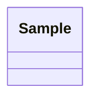

## Schema proposal

### Class diagram


### MIE
```yaml
schema_info:
  title: 熱電材料の試料表
  keywords: [thermoelectric, sample]
  categories: []
```

### 9. Declarative mapping spec

```yaml
version: 1
prefixes:
  ex: "https://kumagallium.github.io/asterism/example/te-samples#"
  exr: "https://kumagallium.github.io/asterism/example/te-samples/"
  qudt: "http://qudt.org/schema/qudt/"
maps:
  - name: sample
    source: samples.csv
    subject:
      template: "exr:sample/{試料id}"
      classes: [ex:Sample]
      label: 試料
    properties:
      - predicate: ex:material
        column: 材料
        label: 材料
      - predicate: ex:firing_temperature
        column: 焼成温度_K
        datatype: xsd:double
        label: 焼成温度
        unit: K
      - predicate: ex:zt
        column: ZT
        datatype: xsd:double
        label: ZT
```
