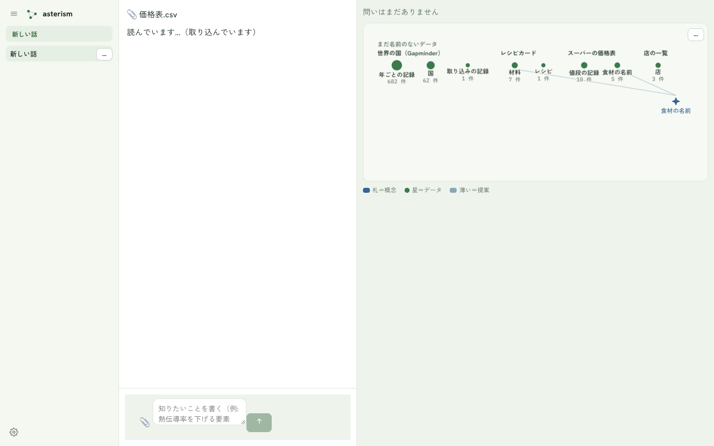
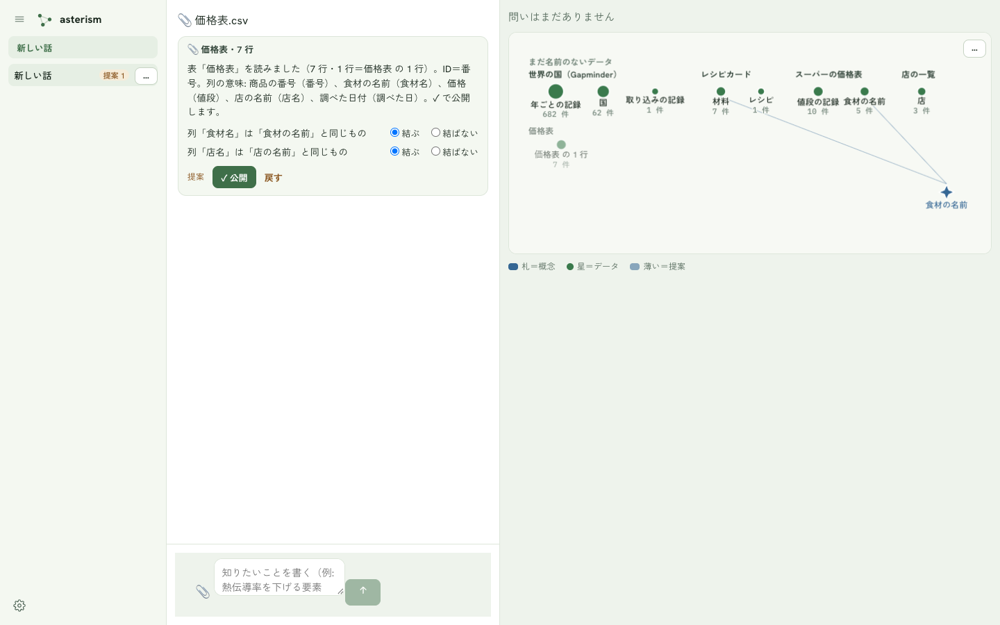
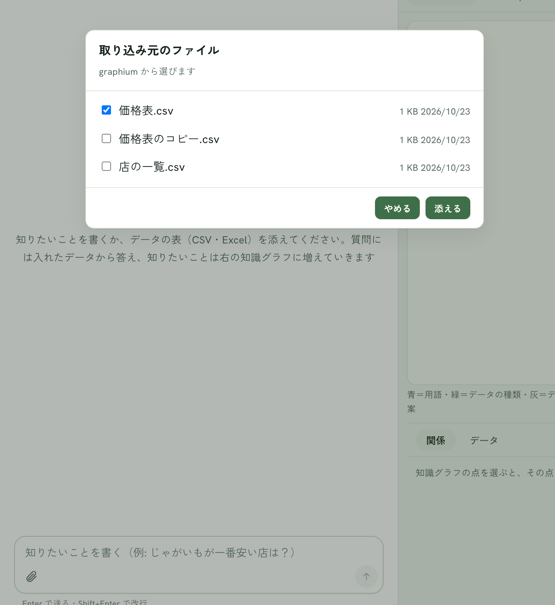
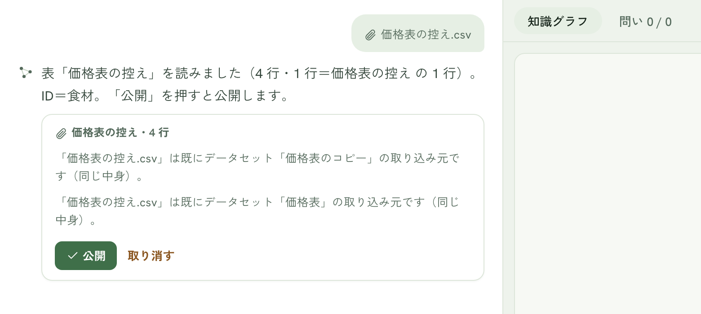
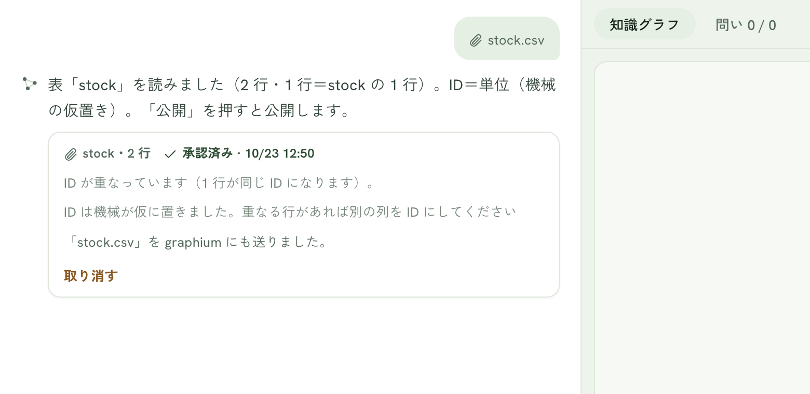

<!--
  Asterism マニュアル（人間向けヘルプ = AI 相談チャットの知識、単一の真実源）。
  getting-started.md の冒頭コメントに書いた表記規約（ボタンは「文言」ボタン、
  タブは「文言」タブ、サイドバーのメニュー項目はメニューの「文言」の形で書く
  こと）は本ファイルにも適用される。
-->

# データの追加 — クリップで添える・対応ファイル・読み取りの確認

表を添えて公開するまでの流れと、置けるファイルの種類、AI が未設定のときのかんたんモードの画面をまとめます。

## クリップで表を添える

チャットの入力欄のクリップ を押して、ファイルを選びます（複数選べます）。

1. 人の手番として「クリップ 価格表.csv」が出て、「読んでいます…」と進みます。サーバが読み取りの段を順に通します
2. 返事が 1 枚返ります。「表「価格表」を読みました（N 行・1 行＝値段の記録）。ID＝番号」と、列の意味、既存の用語と結べる列が並びます
3. 列ごとに「結ぶ」か「結ばない」を選びます。ID の候補が複数あるときは、選択肢から選んで「決める」を押します
4. 「公開」を押すと公開されます。公開のあと、答えられる問いの提案が続きます

読み取りが途中で止まったときは「読み取りが途中で止まりました」、表が読めないときは「表を読めませんでした」と出ます。話を開き直しても、
読み取りは続きから見られます。AI に渡るのは、列の見出しと型、何の行かの説明だけで、データの値は渡しません。

AI が未設定のときは、クリップで右の領域に「データを添える」としてかんたんモードの 7 ステップが開きます（[はじめる](./getting-started.md#AI-未設定のとき)）。
終わると「閉じる」ボタンで知識グラフに戻ります。

## 論文を添える <Badge type="tip" text="v0.62.0 (2026-11-04) で追加" />

クリップで論文（PDF・Word・JATS XML）も添えられます。表と同じように選びますが、表と論文を一緒には添えられません（「表と論文は別々に添えてください」と出ます）。

- 返事の見出しに「論文名・節 N・文 M」が出ます。承認すると知識グラフに論文が灰の点で置かれ（節や文は点にしません）、回答で論文の文を引用できるようになります
- 論文の読み取りに AI は使いません。AI が未設定でも添えられます
- AI が設定されていれば、読み取りのあとに、論文の文から用語・関係・問いの提案が返事に並びます。関係の行の下には、その関係を読み取った論文の文（根拠の文）が小さく出ます。AI は関係と根拠の文の番号だけを選び、用語（名前・種類・既存の用語との一致）と問いは機械が組みます。引用の文は機械が論文から引きます。両端の用語が根拠の文に出てこない関係は除かれます（「根拠の文か用語の種類が合わない関係を N 件除きました」）。長い論文は 150 文だけを読みます（要旨・結果・考察・結論を優先）。形の合わない提案はその 1 件だけを除きます。除いた関係は理由ごとに件数が出ます（根拠の文・用語の種類・問いと関係の数の上限）。どの関係にも問いにも出ない用語は提案から除かれ、問いにつながる形にできないときは提案を出さず論文だけを添えます
- 承認は 1 つで、論文の公開と提案の承認をまとめて行います。承認した関係には根拠の文が残ります。承認の前に確定できるかを確かめ、通らなければ論文も公開しません。書き込みの失敗などで確定できなかったときは「提案は確定できませんでした（論文は公開しました）」と出ます。論文は公開のままで、直してからもう一度承認できます
- PDF を読むには、デスクトップ版で設定の「PDF の読み取り」から部品を入れます。まだ使えないと「PDF を読み取る部品がまだ使えません」と出ます（入れるか、準備が終わるのを待ってください。Word・JATS XML はそのまま添えられます）。Word は pandoc が無い環境では「Word を読み取る部品（pandoc）がありません」と出るので、PDF か JATS XML で添えてください。画像だけの PDF などは「論文から文を読み取れませんでした」と出ます
- 承認のあと、AI が設定されていて、返事に問いの提案が無かったときは、論文の要旨と結論から答えられる問いの提案が続きます

### 根拠の文を見る <Badge type="tip" text="v0.63.0 (2026-11-05) で追加" />

- 承認した関係の根拠の文は、あとからも見られます。「関係」のタブでは関係の行の下に根拠の文と「論文名 · 節」が小さく出て（2 件以上は「ほか N 件」）、知識の問いの回答では出典に根拠の文が「…」と論文名 · 節で並びます。引用の文は機械が論文から引きます
- 同じ関係を複数の論文が支えると、根拠はどの論文のものも残り、行の下に「論文 k 本」と出ます。すでに確定した関係を別の論文が支える提案には、「既にある関係を、この論文も支えます」と出ます
- 知識グラフでは、論文の灰の点から、その論文が根拠になっている用語へ細い線が伸びます。論文の点を押すと、その論文が支える関係と根拠の文が「関係」のタブに出ます

## 取り込み元のサーバのファイルを添える <Badge type="tip" text="v0.61.0 (2026-10-23) で追加" />

設定の「MCP サーバ」タブで取り込み元のサーバを決めていると（[設定](./settings.md#MCP-サーバ-タブ)）、
クリップを押したときに「この PC のファイル」と「〈サーバ名〉のファイル」の 2 択が出ます。
後者を選ぶと、そのサーバが持つ表のファイルの一覧（名前・大きさ・日付）が開き、
☑ を付けて「添える」で、この PC から選んだときと同じ流れで読み取りが始まります。

取り込み元から添えたファイルは、どのサーバのどのファイルか（家）と中身の SHA-256 が
データセットに記録されます。同じ中身の表をもう一度添えると（名前が違っても）、返事に
「「X」は既にデータセット「Y」の取り込み元です（同じ中身）」と 1 行出ます。読み取りは
そのまま続くので、別のデータセットとして作るか、やめるかは返事を見て決めてください。

## 公開すると原本が取り込み元のサーバにも送られる <Badge type="tip" text="v0.61.0 (2026-10-23) で追加" />

取り込み元のサーバを決めていて、設定の「承認したデータセットの元の表を、取り込み元の
サーバにも送る」が ☑（既定）のとき、この PC から添えた表を「公開」すると、その原本が
取り込み元のサーバにも送られ、返事に「「価格表.csv」を 〈サーバ名〉 にも送りました。」
と 1 行出ます。同じ中身が既にあれば「既にありました（同じ中身）」になり、増えません。
取り込み元のサーバから選んで添えた表は、もともとそこにあるので送りません。
送れなかったとき（サーバが止まっている・32 MiB 超）も公開は取り消されず、知らせだけ出ます。

## 対応しているファイル形式

クリップで添えられるのは、表と論文です。

- 表: CSV・TSV・Excel（.xlsx）・JSON
- 論文: PDF・Word（.docx）・JATS XML

装置が出力したファイル（.txt / .dat）は、クリップではまだ読めません
（「この形式は添えられません」と出ます）。AI が未設定のときに開くかんたんモードは、次のものも置けます。

- Excel・CSV・装置が出力したファイル（.txt / .dat）
- 文書 — 論文の XML（JATS）・Word・PDF。デスクトップ版で PDF を取り込むには、
  PDF を読み取る部品を 1 回入れます（下の「Word / PDF などの文書」）。画面は、
  いま取り込める形式だけを案内します
- JSON

種類のちがうファイルが混ざっているときは、表（Excel / CSV / 装置ファイル）・
JSON・文書（Word / PDF / XML）を分けて置いてください。置いたら読み取りが
始まりますが、公開するまで内容は誰にも見えません。

置いたファイルが、既にあるデータセットと同じ形だと機械が判断したときは、
同じ形であることを知らせる帯が出ます（かんたんモード）。次のどちらかを選べます。

- 「そのまま追加」ボタン — 設計の確認を飛ばして、既にあるデータセットに足す
- 「設計を見直してから」ボタン — いつもどおり確認してから進む

ここから先は、AI が未設定のときに開くかんたんモードの画面です。

## サンプルデータで試す

手元にファイルが無いときは「まずサンプルデータで試す」ボタンで最後まで
試せます。測定データの例（5 列 20 行）が用意されます。

## 読み取りの確認でできること

ファイルを置くと、先頭 5 行のプレビューが表示され、正しく読み取れているか
確かめられます。表がずれているときは「表が正しく読めていない？」を開くと、
次の内容をその場で変えられ、プレビューが即座に描き直されます。

- 列の分けかた（カンマ／タブ／セミコロン／スペース）
- 表が始まる前の行数
- 文字化けの直しかた（Excel（日本語）／UTF-8）

## AI からの質問に答える

読み取った内容を AI が確認し、あなたしか知らないことだけを聞いてきます。
たとえば次のような質問です。

- 表の前にあった条件らしい行を、表の各行と一緒に記録するかどうか
- 複数のファイルをつなぐ共通の列はどれか

表の前にあった値に項目名が付いていないときは、名前を付ける欄が出ることも
あります。分からなければ空欄のまま進め、あとから直せます。

## Excel の複数シート <Badge type="tip" text="v0.17.4 (2026-08-20) で追加" />

Excel ファイルに表が複数あるときは、使うものを選びます。グラフ用・メモ用の
シートは外しておくと、このあとの確認が楽になります。

## 表の形をととのえる

AI の質問に答えて「この内容で進む」を押したとき、1 つのセルに複数の値が
並んでいる列や、1 つのセルにリスト（著者の一覧など）が入っている列、値の種類そのものが列の値になっている列（たとえば「物性名」
と「値」が別々の列に分かれた表）が見つかると、「表の形をととのえます」画面が
表示されます。何も見つからなければこの画面は出ず、そのまま次に進みます。

見つかった形ごとに 1 つのタブが並びます。タブの左端には、まだ決めていない
ことがあるときは ⚠、確認が済んでいるときは ✓ が付きます。画面の上には
「入力 ○○ 行 → 派生表 ○○ 行・捨てた要素 ○ 個・切った要素 ○ 個」という帯が
常に表示され（画面をスクロールしても上に残ります）、判断表を変えるたびに
この数字も更新されます。計算し直している間は、帯の中とそのボタンにくるくるが
出ます。

- **使う／使わない** — 同じ種類の値の、綴りのゆれをまとめた表です。使う表には
  チェックが入っています。外すと、その表は作られません（元の表にはそのまま
  残ります）。
- **同じ単位とみなす** — 「別の単位で書かれた行」の欄に、同じ種類の値だけれど
  単位の書きかたが違う行の候補が出ることがあります。これは機械が「同じだ」と
  決めるのではなく、**あなたが確かめて選ぶ**判断です。押すと、その行も表に
  含まれるようになります。
- **別の表に合流** — よく似た表を 1 つにまとめたいときに使います。合流させた
  側の表は使われなくなります。この 2 つの操作は、表の右端の「操作」欄に
  縦に並びます。
- **表の列にする項目** — 入れ子になった値（たとえば `sample_info`）から、
  1 行 1 件の表の列にしたい項目を選びます。項目名には「MaterialFamily 20%」の
  ように、元の表のうちその項目に値が入っている行の割合が添えられます。
  はじめは割合が 25% 以上の項目にチェックが入り、残りは「ほかの項目 ○ 個を
  表示」を押すと開きます。分野が混ざったデータでは、分野に特有の項目は全体に
  対する割合が低くなるので、必要なものは自分で選べます。
- **表の列にする中身** — 項目の中身が複数ある（category・comment など）とき、
  どの中身を列にするかを選べます（1 つは必ず残ります）。選んだ中身の数だけ、
  項目ごとに列ができます。
- **列にする項目（リストの列）** — 1 つのセルにリストが入っている列は、1 つの
  値を 1 行にした細長い表になります。リストの中身が項目を持つとき（著者の
  family・given など）は、どの項目を列にするかを選びます。外した項目は
  消えず、まとめて 1 つの列に残ります。全部外してもかまいません。
- **順番** — リストの並び順は、「何番目か」の列に残ります（著者の順番など）。
  リストとして読めなかったセルは、元の表にそのまま残り、画面に件数が出ます。
- **追加で持ち回る列** — 派生表にも残しておきたい、元の表の列を選べます。

準備ができたら、次のどちらかを選びます。

- **ととのえて進む** — 選んだ内容で表を作ってから、次の画面（AI が読み取る
  意味づけ）に進みます。
- **このまま進む** — 表の形はととのえず、元の表のまま次に進みます。あとから
  やり直したいときは、「入れる」からもう一度やり直してください。

## Word / PDF などの文書 <Badge type="tip" text="v0.6.0 (2026-06-16) で追加" />

論文の XML（JATS）・Word・PDF の文書は、AI を使わずそのまま取り込めます。
文書名を付けて取り込み、読み取りが終わったら公開すると、文ごとに検索・引用
できるようになります。PDF はレイアウトも読むため、数分かかることがあります。
文字が画像になっているスキャン画像の PDF は読み取れません。

デスクトップ版では、論文の XML（JATS）と Word はそのまま取り込めます（Word を
読み取る部品はアプリに同梱しています）。PDF は、PDF を読み取る部品（約 1.7GB）を
1 回入れると取り込めるようになります。入れ方は
[settings.md](./settings.md#PDF-の読み取り) を参照してください。PDF の読み取りは
パソコンの中で行い、読み取りのために PDF を外へ送ることはありません。 <Badge type="tip" text="v0.51.0 (2026-10-07) で追加" />

画面は、いま取り込める形式だけを案内します。取り込めない形式があるときは、
次のようになります。

- ファイルを置く欄の下に「PDF は、読み取る部品を入れると取り込めます。」と
  出て、「設定を開く」ボタンから部品を入れる画面に進めます
- ファイルを選ぶ画面では、その形式のファイルは選ぶ対象から外れます
- それでも選んだり、ドラッグして置いたりしたときは、取り込みを始める前に
  その場で知らせます

サーバ版では、PDF を読み取る部品が設定されていないサーバのとき、PDF だけが
取り込めません（「PDF は、このサーバでは取り込めません」と出ます）。古い版の
デスクトップ版では、Word・PDF とも取り込めないことがあります。アプリを更新
してください。

## 前回の続き <Badge type="tip" text="v0.16.0 (2026-08-17) で追加" />

前に置いたファイルがブラウザに残っているときは、「このファイルの続きから
使う」か「新しいファイルを置く」かを選べます。同じファイルをもう一度置くと、
前回の確認の続きから再開できます。

## 書き込みに利用許可コードが必要な環境

このサーバへの書き込みに利用許可コードが必要な環境では、設定に入力すると
先に進めます。詳しい手順は [settings.md](./settings.md) を参照してください。

## 関連

- 「入れる」からあとの手順全体は [getting-started.md](./getting-started.md)
- 取り込んだあとの管理・公開は [datasets.md](./datasets.md)
