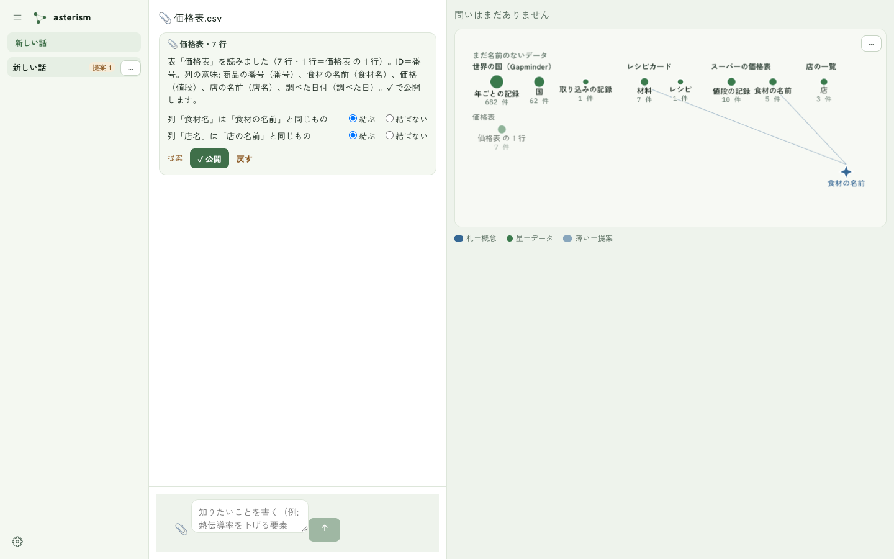

<!--
  Asterism マニュアル（人間向けヘルプ = AI 相談チャットの知識、単一の真実源）。
  getting-started.md の冒頭コメントに書いた表記規約（ボタンは「文言」ボタン、
  タブは「文言」タブ、サイドバーのメニュー項目はメニューの「文言」の形で書く
  こと）は本ファイルにも適用される。
-->

# つながり — 別々のデータを共通の値でつなぐ仕組み <Badge type="tip" text="v0.3.0 (2026-06-13) で追加" />

つながりの画面はありません。ここでは、残っている仕組みだけを説明します。

## つながりとは

別々のデータに同じ値（試料名・組成など）があると、それを手がかりに両方を
またいで質問できるようになります。これが「つながり」です。作るときに AI は
使いません。実際の値どうしを機械的に突き合わせて、共通の値を見つけます。

つなぎ方は 1 つに限りません。同じデータどうしでも、別の手がかり（組成でつ
なぐ、著者でつなぐ、など）で新しいつながりを増やせます。

## 表を添えると自動で結ばれる

表を 📎 で添えると、返事に「列の結びつき」が出ます（「列「price」は「価格」と同じもの」など）。
「結ぶ」を選んだ列どうしは、値が重なっていれば、✓ で公開したときに自動で結ばれます。手作業は要りません。

- 名前が既存の用語と完全に一致した関係は、公開のあと、機械の手番として同じ話に出ます。「✓ 確認」で確定し、「戻す」で見送ります
- 結ばれた結果は、図のつながりの点に出ます。押すと「つながり」の 1 枚が開きます（参加している種類が並びます）
- 値の重なりを探すのは機械で、AI は使いません。AI に渡すのは列の見出しと型だけで、値は渡しません

## 同じものは 1 つのページ <Badge type="tip" text="v0.46.0 (2026-09-29) で追加" />

結ばれた列が指す対象は、データセットが違っても 1 つにまとまります。同じ対象のページが 2 つできることはありません。
まとまったものは、チャットで「…を見せて」と書くと、つながっているデータセットの記録が表で返ります（[見る](./workspace.md)）。

## 同じ値とみなす基準（正規化）

表記のゆれをどこまで同じ値として扱うかの基準です。画面で選ぶ場所はなく、仕組みとして残っています（サーバの API から指定します）。

| 基準 | 内容 |
|---|---|
| そのまま一致 | 表記が完全に同じものだけをつなぐ |
| 大文字・小文字を無視 | FeO と feo を同じとみなす |
| 空白の違いを無視 | 前後・連続する空白の違いを無視する |
| 全角・半角を揃える | 全角・半角や互換文字の違いを無視する |
| ゆるく一致 | 大文字小文字・空白・全角半角をまとめて無視する |
| 組成式として揃える | 添字や空白の違いを吸収する（元素の並び順は区別） |
| 組成式＋元素順も揃える | 元素の並び順が違っても同じ組成として扱う |
| カスタム | 手順（プリミティブ）を自分で組み合わせて基準を作る |

組成には大文字・小文字を無視する基準は使えません（Co と CO は別の元素なの
で、同じ値とみなすと間違った一致になります）。

## 追加の一致条件 <Badge type="tip" text="v0.5.0 (2026-06-15) で追加" />

つなぐ概念だけでなく、複数の条件がすべて一致したときだけつなぐ、という指
定も仕組みとしてできます（これも API から指定します）。たとえば「組成」かつ「結晶系」が両方一致したときだけつなぐ、
といった使い方です。

## できたつながりの画面

作ったつながりの画面では、次のことが確認できます。

- 両方に出てくる値の一致数と、つながっているデータの件数
- またいで使える道具（この値は何データセットが報告しているか、をその場で
  調べられます。一致した値どうしの照合そのものは AI を使いません。道具パ
  ネルから新しい道具を作るときは AI に下書きさせることもできます）
- 「最新のデータで作り直す」ボタン（つないだあとにデータを追記したときに
  押します。公開されていないデータは、作り直しても入りません）
- 「このつながりを削除」ボタン <Badge type="tip" text="v0.36.0 (2026-09-02) で追加" />（確認のうえで、つながりそのもの＝結合のグラ
  フと設定を消します。元のデータセットには触れないので、同じ設定でいつでも
  作り直せます）

## 追加の一致条件 <Badge type="tip" text="v0.5.0 (2026-06-15) で追加" />

つなぐ概念だけでなく、複数の条件がすべて一致したときだけつなぐ、という指
定も仕組みとしてできます（これも API から指定します）。たとえば「組成」かつ「結晶系」が両方一致したときだけつなぐ、
といった使い方です。

## 関連

- データに質問する流れは [ask.md](./ask.md) を参照してください。
- 項目名や用語を揃える話は [vocab-and-grounding.md](./vocab-and-grounding.md)
  を参照してください。
