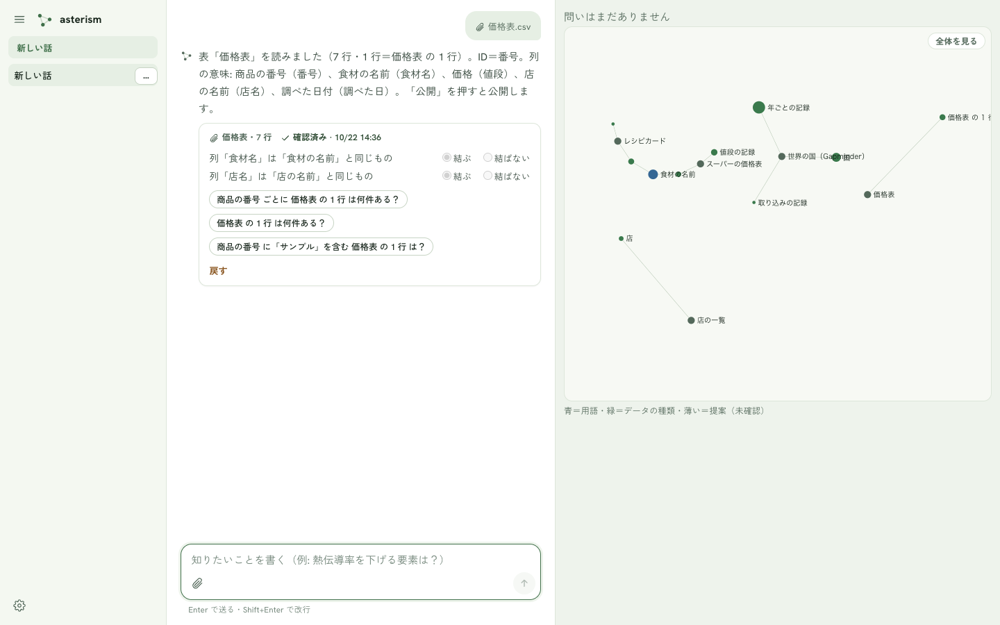

<!--
  Asterism マニュアル（人間向けヘルプ = AI 相談チャットの知識、単一の真実源）。
  getting-started.md の冒頭コメントに書いた表記規約（ボタンは「文言」ボタン、
  タブは「文言」タブ、サイドバーのメニュー項目はメニューの「文言」の形で書く
  こと）は本ファイルにも適用される。
-->

# データセットの管理 — 公開・見直し・削除

データセットの一覧や詳細の画面はありません。公開済みのデータは図に丸（データの種類）として並び、公開と見直しはチャットで行います。
公開までの流れそのものは [getting-started.md](./getting-started.md) を参照してください。

## 公開する

クリップで添えた表の返事にある「公開」を押すと、このサーバを使う人が質問したときに、このデータが
出典つきで引用されるようになります（それまでは誰にも見えません）。公開したデータは、図の丸が濃くなります。
未公開の表は、図に薄い星座として出ます。

公開のあと、名前が既存の用語と完全に一致した関係があれば、機械の手番として同じ話に出ます。「確認」で確定します。

## 見直す

設計を見直したいときは、次のどちらかです。

- **クリップで同じ表を添える** — 直したい表をもう一度添えます。読み直され、返事の列の意味・ID・結びつきを見直して、「公開」で公開し直します
- **データの削除** — 取り込んだ表が合わないときは、その返事の「戻す」を押します。取り込んだ未公開のデータが消えます
  （消せなかったときは注記が出ます）。話を消したときも、その話で取り込んだ未公開のデータは消えます

直したい内容は、チャットに書いて伝えます（例: 「ID を DOI にする」）。ID の候補が複数あるときは、返事の中の選択肢から選んで
「決める」を押します。

AI が未設定のときは、クリップで開くかんたんモードの「ためす」から、「⑤ かたちをたしかめる に戻る」ボタンや
「この意味を保存して戻る」ボタンで戻って直せます（[はじめる](./getting-started.md#AI-未設定のとき)）。

## 設計を見直す <Badge type="tip" text="v0.9.0 (2026-07-23) で追加" />

見直しで何を直したかによって、そのあとの動きが変わります。

- 項目の意味・単位だけを直したとき <Badge type="tip" text="v0.51.0 (2026-10-07) で追加" /> — データを作り直さずに書き換わります
- 種類の分け方・つながり・ID を変えたとき — 同じデータセットのまま新しい版として作り直され、公開すると切り替わります

公開したあとに ID の作り方（データの数えかた）を変えると、前の ID には
新しい ID への引っ越し先が記録され、すでに配った引用から新しい内容に
たどれます
<Badge type="tip" text="v0.22.2 (2026-08-27) で追加" />。

ただし、引き継げない ID が出ることがあります。前の ID を作るのに使っていた
列がいまのファイルに無いとき、前に作っていた種類が新しい設計に無いとき、
取り込みの途中で引っ越し先を記録できなかったときです。公開の前には
「ID の引っ越し」の欄が出て、引っ越し先が記録された ID が
何件あるかと、引き継げないぶんがあるときは、どのファイルのぶんが、なぜ
引き継げないかを確かめられます。この欄は、かんたんモードの「公開する」
ステップに出ます。

引き継げないぶんがあっても、そのまま公開できます。前の ID を残したいときは、
公開の前に ID の作り方を元に戻してください。かんたんモードでは「ためすに戻る」
ボタン →「⑤ かたちをたしかめる に戻る」ボタンで戻れます。
元に戻して取り込み直すと、「ID の引っ越し」の欄は出なくなります。

## 気になる点 <Badge type="tip" text="v0.11.0 (2026-07-24) で追加" />

つながっていないデータ・使われていない列・数値が文字として記録されている列などの指摘は、返事の中の注記として出ます。
直し方も 1 行で添えられます（例: 「ID を DOI にする」と書く）。

## 公開済みのデータの削除

公開済みのデータを削除する専用のボタンは、この画面にはありません。公開をやめたり削除したりする操作は、サーバの API で行います。
データと ID は残る形で公開をやめられるので、すでに引用されたリンクは壊れません。

## 関連

- 公開までの流れは [getting-started.md](./getting-started.md)
- データセットどうしのつながりは [crosswalk.md](./crosswalk.md)
