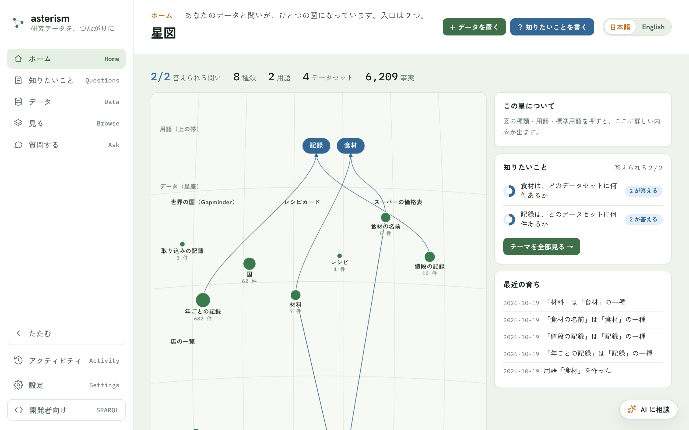
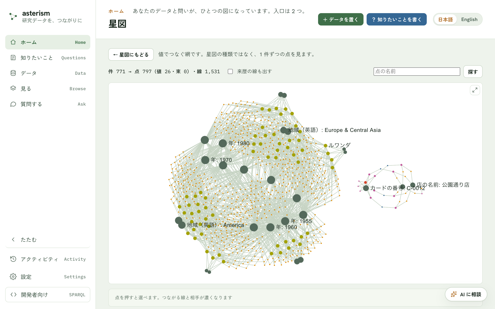
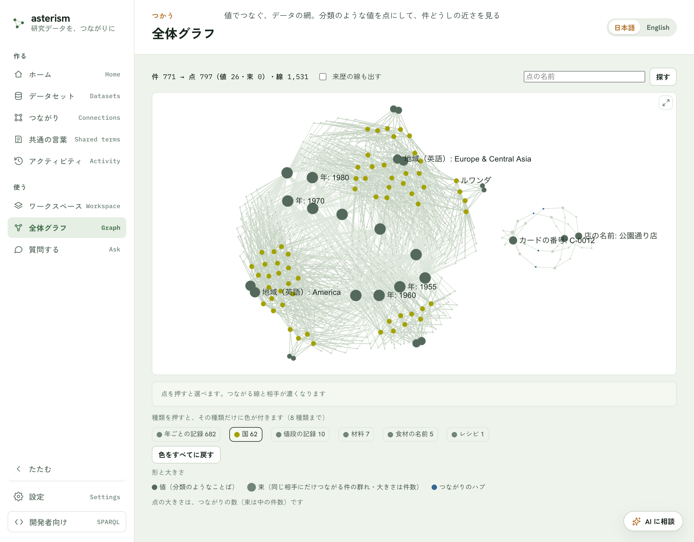

<!--
  Asterism マニュアル（人間向けヘルプ = AI 相談チャットの知識、単一の真実源）。
  getting-started.md の冒頭コメントに書いた表記規約（ボタンは「文言」ボタン、
  タブは「文言」タブ、サイドバーのメニュー項目はメニューの「文言」の形で書く
  こと）は本ファイルにも適用される。
  ファイル名は graph.md のまま。章は「星図」（ホーム）に書き直した（UI 再設計 PR 2）。
  以前の「全体グラフ」は、星図の「中身まで見る」に入った。
  画面の写真は本体が撮って差し込む（星図の写真は撮り直しまち。「中身まで見る」の
  2 枚は従来の画面のまま使える）。バッジは、リリースの版と日付が決まってから付ける。
-->

# 星図 — データと問いが、ひとつの図になる

## 星図とは

アプリを開いたときのホームです。公開したデータと、知りたいこと（問い）が、
1 枚の紙の星図になって見えます。「今あるデータで、どの問いに答えられるか」を
ひと目で見るための画面です。

| 図の中のもの | 描きかた |
|---|---|
| 種類 | 緑の星。大きさは件数（表示中の最小〜最大の対数で、面積に比例）。名前は星の下、件数はその下 |
| データセット | 星座。中の種類を細い線で結び、名前を添えます（枠は引きません） |
| 用語 | 上の帯の青い札。種類から札へ線が伸び、「〜の一種」は矢じり付き、「同じもの」は矢じり無し。星がまだ無い用語は薄い青で「まだ星がない」と出ます |
| 標準用語 | 下の帯（地平線）の琥珀色の札。用語の札の下に「≡ cmso:Material」のような小さな字が出ます |
| つながり | 星座のあいだにある青い 4 つ角の星。参加している種類へ線が伸びます |

同じデータからは、いつも同じ絵が描かれます（配置は毎回同じ手順で決めます）。
データセットは公開の古い順に並び、新しく公開したデータセットは最後に加わります。
すでにある星座の位置は動きません。

## 見かた

- 一番上の 1 行は「答えられる問い N / M」だけです（M 個の問いのうち、答えるデータがある問いが
  N 個。問いが 1 つも無いときは「問いはまだありません」）。種類・用語・データセット・事実の数は、
  図の右上の「…」の「数で見る」で読めます。
- 図の直下の 1 行は凡例です（● 種類　● 用語・つながり　● 標準用語）。
- 点（星・札・丸）にマウスを載せると、その点につながるものだけが濃くなり、ほかは薄くなります。
- 名前は、重ならないものだけが出ます。件数の多い星の名前から先に出ます。
  マウスを載せた点の名前はいつも出ます。
- 種類が 60 を超える、またはデータセットが 8 を超えると、データセットを 1 つの丸にまとめます。
  丸の大きさはデータセットの件数で、押すと中の種類が右に出ます。

## 右の欄

図の右には、カードが 1 枚だけ出ます。点を選んでいれば「この星について」、選んでいなければ
「知りたいこと」です。

- **この星について** — 星・丸・用語・標準用語・つながりを押すと、ここに詳しい内容が出ます。
  - 星: 名前、主ボタン「◯◯ を見る」（その種類のページ＝[見る](./workspace.md)へ 1 クリック）、
    データセット（押すとそのデータセットのページ）、件数、入っている用語、標準用語。
    その下に AI との「相談」があり、さらに下に「手で決める」（「ひとこと決める」を畳んだもの。AI が未設定のときは相談が出ず、開いた状態で出ます）があります。
    この種類に掛かる決めたことがあれば、「決めたこと N 件 →」から、その種類に掛かるものだけの一覧に入れます。
  - 用語: 主ボタン「◯◯ を見る」（用語のページ）、入っている種類、答える問い、標準用語。星がまだ無い用語には、データを置くと星が入る、と出ます。
  - 標準用語・つながり: 1 行の説明と、結ばれている用語・種類。
- **知りたいこと** — 問いの一覧です。丸の満ち方は、答えるデータセットの数（公開したデータセット全体に
  対する割合）。押すと、その問いに要る用語の札が出て、図でも光ります。「テーマを全部見る」で[知りたいこと](./vocab-and-grounding.md)へ移ります。

公開した直後と、ひとこと決めた直後に答えられる問いが増えたときだけ、欄の上に「答えられる問い 5 → 6」と
6 秒だけ出ます。

## 育つ瞬間

かんたんモードで公開を終えた画面の「星図を見る」ボタンから星図に移ると、公開した種類の星が
1 度だけ灯ります（輪が広がります）。リロードしても繰り返しません。

## 「…」の操作 — 静かな表示・数・画像

図の右上の「…」を押すと、次の 4 つが出ます。

- 「静かな表示」— 灯る動きを止めます。選びはこのアプリに覚えられます。OS の「視差効果を減らす」
  設定も同じに扱います。
- 「画像で保存」— いまの星図を PNG にして保存します（選びや濃淡は入りません）。
  デスクトップ版では保存に対応していません。ブラウザ版から保存してください。
- 「数で見る」— 種類・用語・データセット・事実の数と、図と同じ内容の表（星座・星・件数・用語・
  標準用語）を開きます（読み上げやコピー用）。
- 「中身まで見る」— 下の節の、値の網に移ります。

## 空のとき

- データも問いも無いとき: 見本の星図が薄く重なり、「ここに、データと問いから星図が育ちます」と
  出ます。入口は「＋ データを置く」「？ 知りたいことを書く」の 2 つです。ふだんは図の上の行の右にあります（図の星や札に重ならないよう、図の外に置いています）。
- データだけがあるとき: 「用語の無い種類が N 個あります」と出ます。知りたいことを書くと、
  名前が付きます。
- 問いだけがあるとき: 「答えるデータがまだありません」と出ます。データを置くと、合う種類を探します。

## 中身まで見る（値の網）

図の右上の「…」から「中身まで見る」を選ぶと、同じ場所に、公開したデータ全体を 1 枚の網として
見る画面が開きます（アドレスは `#/home?deep=1`。以前の `#/network` もここに着きます）。
星図が種類の設計図なのに対し、こちらは中身そのものの網です。「星図にもどる」で戻ります。

- 件（1 つ 1 つのデータ）と、件どうしのつながりが点と線になります。
- 地域や年のような、少ない種類の値を何度も使う項目は、その値も点になります。
  同じ値を使う件が、その点のまわりに集まります。
- 同じ相手にしかつながらない件が 20 件以上あれば、1 つの束にまとめます
  （たとえば測定点が 3,000 件あっても、束の点 1 つになります）。
- 取り込みの記録のような来歴の線は、はじめは出しません。

### 見かた

- 上の一行は、件の数から点と線がいくつになったかの集計です
  （例: 件 3,800 → 点 776（値 25・束 2）・線 1,497）。
- 点の色は種類ごとに決まっていて、データが増えてもほとんど変わりません
  （ほかの種類と色がぶつかったときは、隣の色になります）。
  色が付くのは 8 種類までで、残りは灰色です。図の下の凡例で種類を押すと、
  その種類だけに色が付き（8 種類まで）、ほかは灰色になります。
  「色をすべてに戻す」で元に戻ります。

  

  値の点は濃い灰色、つながりのハブは青、束は大きめの丸で、中の件数が
  大きさになります。大きさはつながりの数で決まります。
- 名前が同じ種類は、凡例でデータセット名を添えて見分けます。選んだ点の帯にもデータセット名が出ます。
- 名前は、重ならないものだけが出ます。拡大すると細かい名前も出てきます。
  点にマウスを載せると、その点につながる線と相手がいったん濃くなり、名前も出ます。
- ホイールで拡大・縮小、ドラッグで動かせます。凡例は図の下にあります。

### 操作

- 点を押すと選べます。選んだ点につながる線と相手だけが濃くなり、ほかは薄くなります。
  何もないところを押すと選びを外します。
- 図の下の帯に、名前・種類・つながりの数が出ます。
  - 件とハブ: 「このページを開く」で、その 1 件のページへ移ります。
  - 値と束: 「一覧で開く」で、その値を持つ件（束なら束の中の件）の絞り込みの
    ページへ移ります。
- 「来歴の線も出す」を入れると、取り込みの記録などの線と点が加わります。
- 「名前で探す」に入力して「探す」ボタンを押すと、一致した点に寄って選びます。
- 右上のボタンで「大きく見る」ことができます。選びや拡大の状態はそのままです。
- 点が多すぎるときは「点が多いので一部だけ出しています」と出て、つながりの
  多い点から残します。

## 関連

- 種類だけの設計図は、データセットの詳細の「中身」タブの末尾の「ほかのデータセットとの関係の図」（[用語の地図](./vocab-and-grounding.md#用語の地図)）。
- 1 件から広げて見るのは[見る](./workspace.md)の「つながりを図で見る」。
