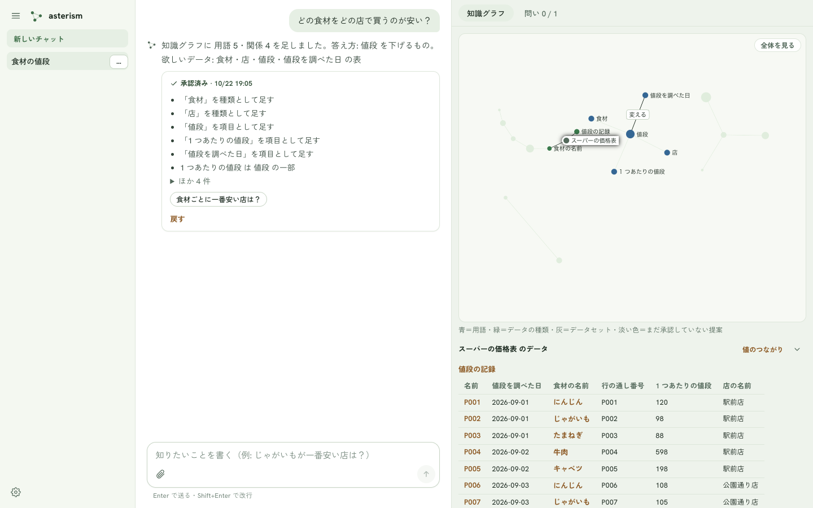
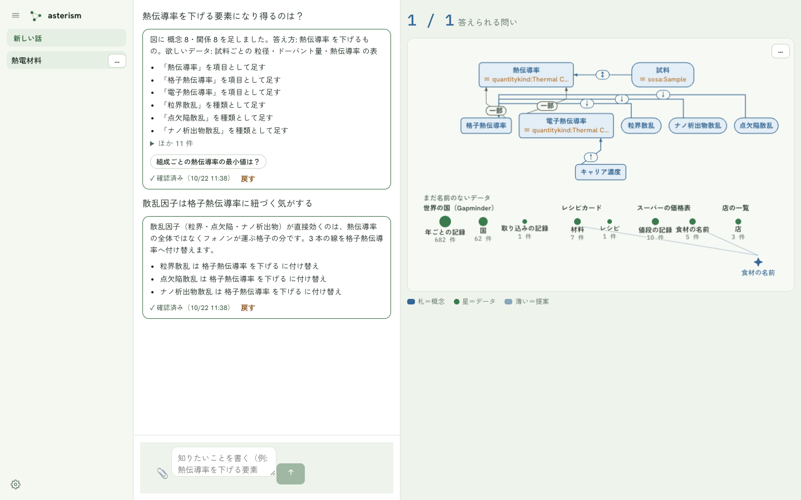
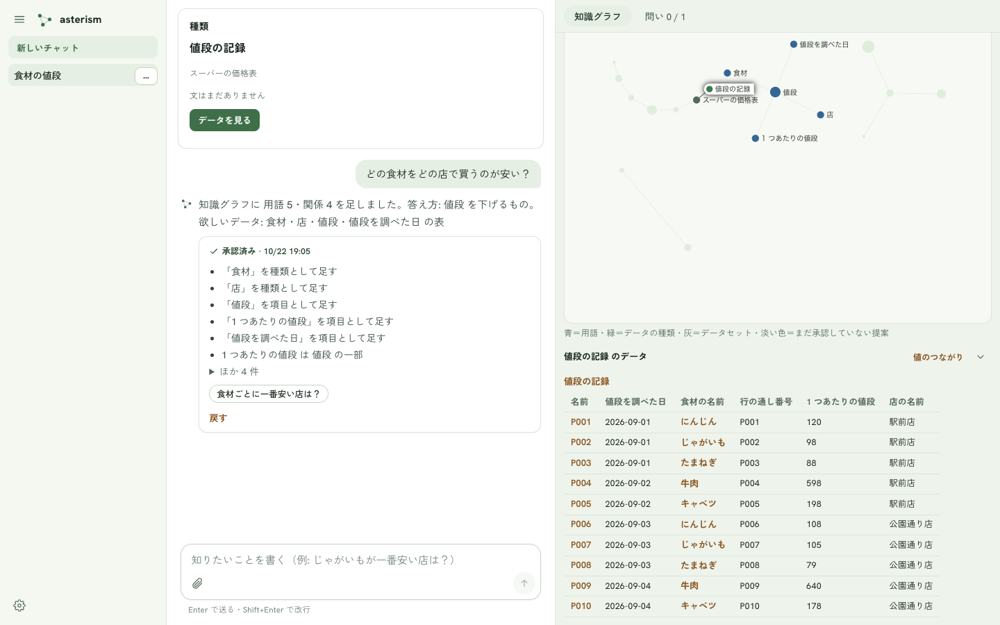
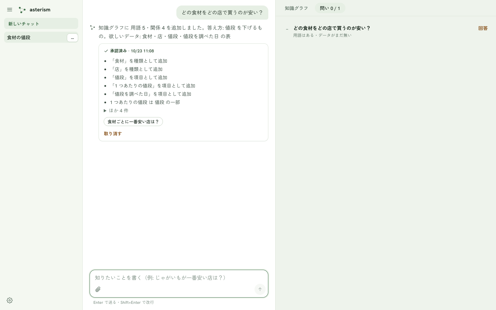
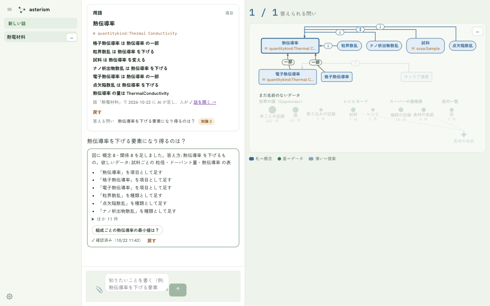
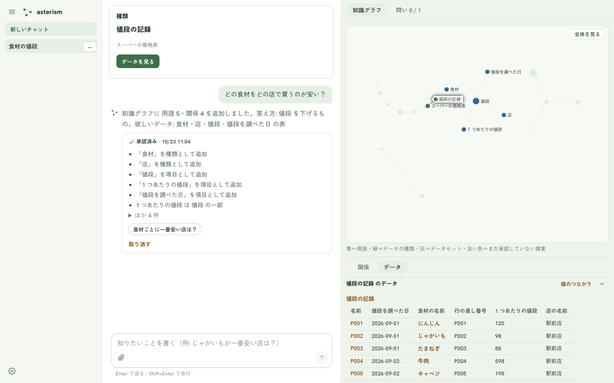
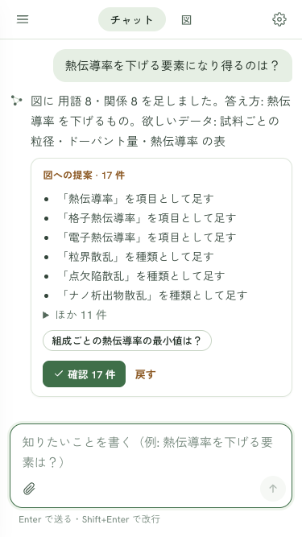
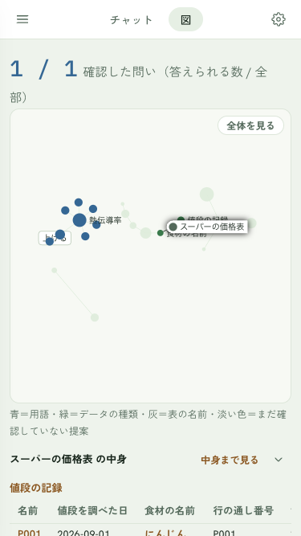

<!--
  Asterism マニュアル（人間向けヘルプ = AI 相談チャットの知識、単一の真実源）。
  getting-started.md の冒頭コメントに書いた表記規約（ボタンは「文言」ボタン、
  タブは「文言」タブ、サイドバーのメニュー項目はメニューの「文言」の形で書く
  こと）は本ファイルにも適用される。
  ファイル名は graph.md のまま。章は「知識グラフ」（右の領域）。以前の「全体グラフ」は、知識グラフの「値のつながり」に入った。
-->

# 知識グラフ — 全体・データ・問い

## 知識グラフは状態の正本

画面の右の領域が知識グラフです。話した内容（問い・用語・関係）と、公開したデータが知識グラフになります。
「今あるデータで、どの問いに答えられるか」をひと目で見るためにあります。
右の領域は、一番上に 2 つのタブがあります。

| タブ | 出るもの |
|---|---|
| 知識グラフ（最初に開くほう） | 全体の図（何があるか＝用語とデータの種類）→ 凡例 1 行 → 「データ」（押した点の実際の行） |
| 問い N / M | 承認した問いの一覧。N＝今のデータで答えられる数、M＝承認した問いの全部（薄い提案の問いは数えない） |

## 全体の図

公開済みの用語とデータの種類を、全部まとめて見る図です。丸と、その横の文字で描かれます。

| 図の中のもの | 描きかた |
|---|---|
| 青い丸 | 用語（種類か項目） |
| 緑の丸 | データの種類（公開した表の種類）。大きさは件数の対数 |
| 灰色の丸 | データセット。種類を束ねる |
| 薄い丸 | 提案（AI が足したが、まだ承認していない） |
| 濃い丸 | 承認済み（承認で確定した） |
| 外す提案 | 承認済みのものに「戻す」を押すと、橙の塗りで示される。承認で確定する |

- ホイール（タッチなら 2 本指）で拡大・縮小し、ドラッグで動かします。
- 点にマウスを載せると、その点の周りだけが濃くなり、名前が出ます。
- 用語どうしをつなぐ線に触れると、関係の名前（一種・一部・下げる・上げる・変える）が出ます。
- 右上の「全体を見る」で、全体が収まる大きさに戻ります。
- 丸を押すと、チャットの先頭に 1 枚が出て、下の「データ」も変わります（下の「点を押す 1 枚」「データ」）。
- 名前は、重ならないものだけが出ます。拡大すると細かい名前も出てきます。
- 図の下の凡例に「青＝用語・緑＝データの種類・灰＝データセット・薄い＝提案（承認前）」が出ます。
- 同じ内容なら、いつも同じ図が描かれます。
- 何もないときは「まだ何もありません。問いを書くか表を添えると、ここに知識グラフが育ちます」と出ます。

## データ（押した点の実データ）

図の下のパネルです。見出しは「〈名前〉 のデータ」。押した点の実際の行が、表で出ます。
表の見え方は、チャットの「〜を見せて」と同じです（行の名前を押すと、図で光ります）。

| 押したもの | データに出るもの |
|---|---|
| 緑の丸（データの種類） | その種類の行を 20 件まで。全件数も出る |
| 青の丸（用語） | 用語に結ばれた各データの表。データごとに小見出し。最大 3 表 |
| 灰色の丸（データセット） | そのデータの種類の表。最大 3 表 |
| 薄い緑の丸（📎 で添えた未公開の表） | 公開前の表 |
| 何も押していない | このチャットで添えた表 |

- 表が 3 つを超えるときは「ほか N 表は「値のつながり」で」と出ます。
- 見出し行を押すと折りたためます（次から覚えます）。
- 右上の「値のつながり」で、値の網に移ります（下の節）。
- 添えた表が無く、何も押していないときは「知識グラフの点を押すと、そのデータがここに出ます」と出ます。
- 行が 0 件のときは「まだ行がありません」と出ます。
- 薄い提案の用語は、承認して公開するまで行がありません。「承認して公開すると、ここに行が出ます」と出ます。

## 問いのタブ

一番上の「問い N / M」を押すと、承認した問いの一覧が出ます。縦にいくらでも並びます。

| 欄 | 内容 |
|---|---|
| 印 | ✓＝今のデータで答えられる・–＝まだ |
| 問いの文 | 承認した問い。並びは話のテーマの順 |
| 下の小さい 1 行 | データの問いは「〈データセット名〉で答えられる」（複数なら「・」でつなぎ、3 つまで＋「ほか n」）か「用語はある・データがまだ無い」。知識の問いは「関係で答えられる（n 本）」 |
| 薄い行 | まだ承認していない提案の問い。「まだ承認していません」と出る |

- 問いの文を押すと、「知識グラフ」のタブに切り替わり、その問いに要る用語と、それに結ばれたデータの種類が光ります。
- 「答えて」を押すと、その問いがチャットに送られ、必ず質問として答えが返ります（[質問する](./ask.md)）。送ったあとは「送りました」になり、押せなくなります。
- 問いが 1 つも無いときは「問いはまだありません。チャットで聞いて「承認」すると増えます」と出ます。

## 薄いと濃い

| 状態 | どうなる |
|---|---|
| 薄い（提案） | AI が返事のたびに足す。承認しなくても消えない。「戻す」で取り消せる |
| 濃い（承認済み） | 返事の「承認」で確定する。来歴が残り、質問やほかの AI からの問い合わせで使われる |

承認済みになったものだけが、質問（[質問する](./ask.md)）と外の AI への回答に使われます。

## 点を押す 1 枚

知識グラフの丸を押すと、チャットの先頭に 1 枚が出ます。同時に、下の「データ」もその点の表に変わります。

| 欄 | 内容 |
|---|---|
| 名前と種別 | 用語・種類・標準用語・つながり・提案 |
| 標準用語 | 「≡」の行。押すと標準用語の 1 枚 |
| 文 | この点にかかる関係を、1 行 1 文で。押すと知識グラフで濃く見える |
| 来歴 | 例: チャット「熱電材料」で 10/22 に AI が足し、人が承認。「チャットを開く →」でその話へ |
| データを見る | 丸のとき。押すと、チャットに表が差し込まれる |
| 戻す | 承認済みは「外す提案」になり、承認で確定。薄いものは取り消し |

丸のうち、まだ公開していない表（データ）の丸は薄く出ます。

## 知識グラフを直す

直すときは、図を触らずチャットに書きます。

- 「粒界散乱は外して」— 外す提案になる
- 「さっきのを戻して」— 直前の返事を取り消す（承認済みの返事は、承認で足した分だけを戻す）
- AI が未設定のとき: 知識グラフの下の「AI なしで足す」から、名前・種別・関係・答え方を決めて「足す」「決める」を押す

## 空のとき

- データも問いも無いとき: 図に「まだ何もありません。問いを書くか表を添えると、ここに知識グラフが育ちます」と出ます。
- データだけがあるとき: 図に緑の丸が並び、データにはこのチャットで添えた表が出ます。問いを書くと、用語が付きます。
- 問いだけがあるとき: 「答えるデータがまだありません」と出ます。表を クリップで添えると、合う種類を探します。

## 狭い画面（375px）

「チャット」「知識グラフ」「問い」の 3 つのタブで切り替えます。「知識グラフ」のタブは、上から図 → 凡例 → データ（折りたたみ）の順です。
緑や青の丸を押すと、1 枚は「チャット」のタブに出ます。データは「知識グラフ」のタブに戻ると見えます。

## 値のつながり（値の網）

「データ」の見出し行の右上にある「値のつながり」を押すと、同じ場所に、公開したデータ全体を 1 枚の網として
見る画面が開きます。図が「何があるか」なのに対し、こちらは値そのものの網です。「星図にもどる」で戻ります。

- 件（1 つ 1 つのデータ）と、件どうしのつながりが、点と点を結ぶ関係になります。
- 地域や年のような、少ない種類の値を何度も使う項目は、その値も点になります。
  同じ値を使う件が、その点のまわりに集まります。
- 同じ相手にしかつながらない件が 20 件以上あれば、1 つの束にまとめます
  （たとえば測定点が 3,000 件あっても、束の点 1 つになります）。
- 取り込みの記録のような来歴の関係は、はじめは出しません。

### 見かた

- 上の一行は、件の数から点と関係がいくつになったかの集計です
  （例: 件 3,800 → 点 776（値 25・束 2）・線 1,497）。
- 点の色は種類ごとに決まっていて、データが増えてもほとんど変わりません
  （ほかの種類と色がぶつかったときは、隣の色になります）。
  色が付くのは 8 種類までで、残りは灰色です。画面の下の凡例で種類を押すと、
  その種類だけに色が付き（8 種類まで）、ほかは灰色になります。
  「色をすべてに戻す」で元に戻ります。

  値の点は濃い灰色、つながりのハブは青、束は大きめの丸で、中の件数が
  大きさになります。大きさはつながりの数で決まります。
- 名前が同じ種類は、凡例でデータセット名を添えて見分けます。選んだ点の帯にもデータセット名が出ます。
- 名前は、重ならないものだけが出ます。拡大すると細かい名前も出てきます。
  点にマウスを載せると、その点につながる関係と相手がいったん濃くなり、名前も出ます。
- ホイールで拡大・縮小、ドラッグで動かせます。凡例は画面の下にあります。

### 操作

- 点を押すと選べます。選んだ点につながる関係と相手だけが濃くなり、ほかは薄くなります。
  何もないところを押すと選びを外します。
- 画面の下の帯に、名前・種類・つながりの数が出ます。
- 「来歴の線も出す」を入れると、取り込みの記録などの点と関係が加わります。
- 「名前で探す」に入力して「探す」ボタンを押すと、一致した点に寄って選びます。
- 点が多すぎるときは「点が多いので一部だけ出しています」と出て、つながりの
  多い点から残します。

## 関連

- 話・用語・標準用語: [話・用語・標準用語](./vocab-and-grounding.md)
- 質問する: [質問する](./ask.md)
