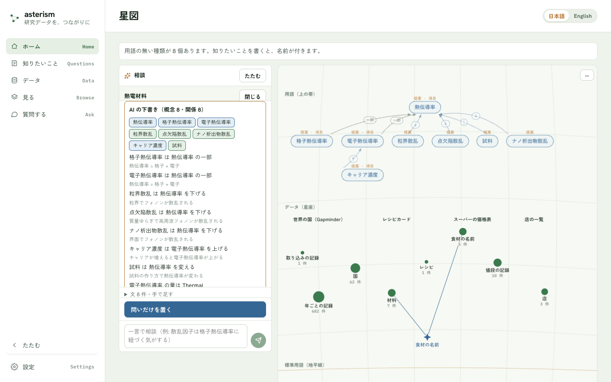
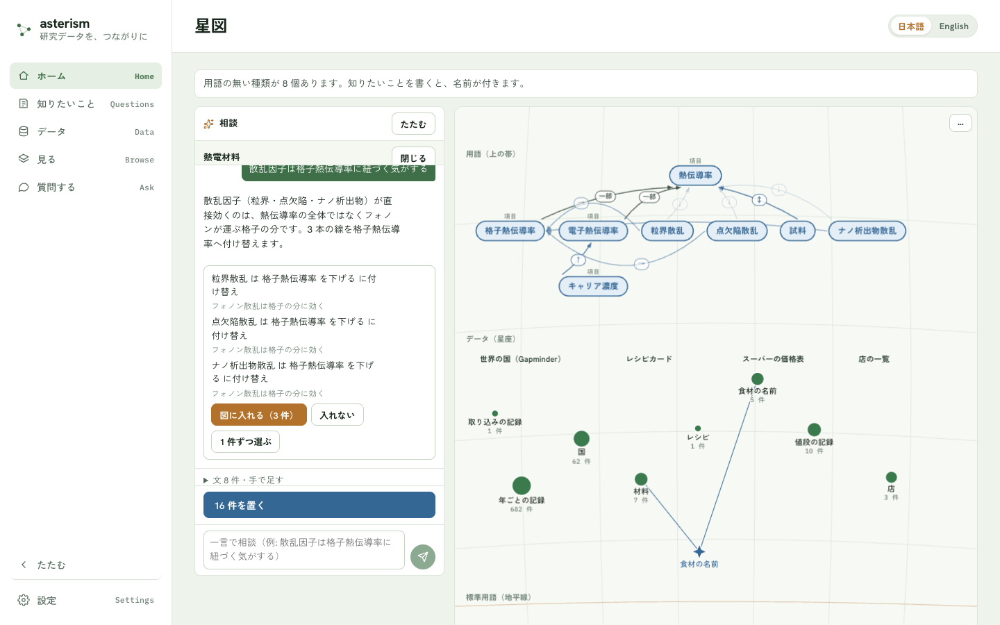
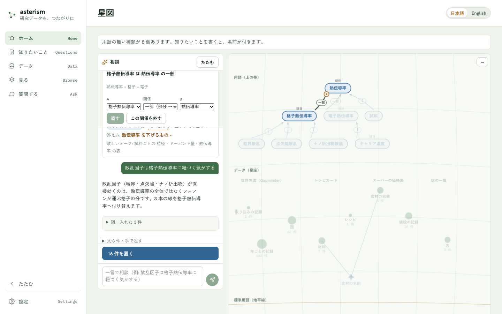
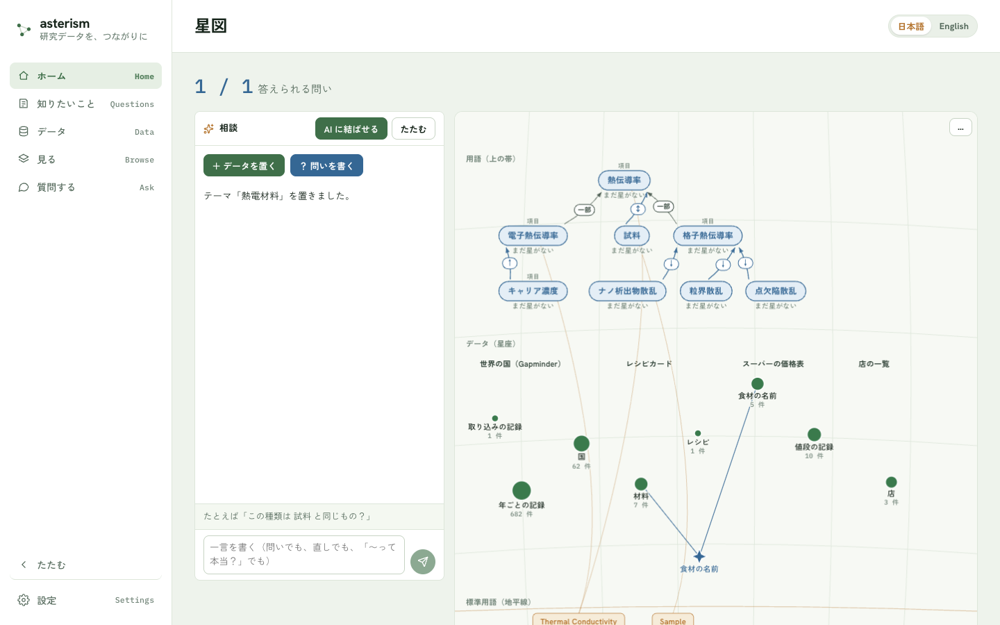
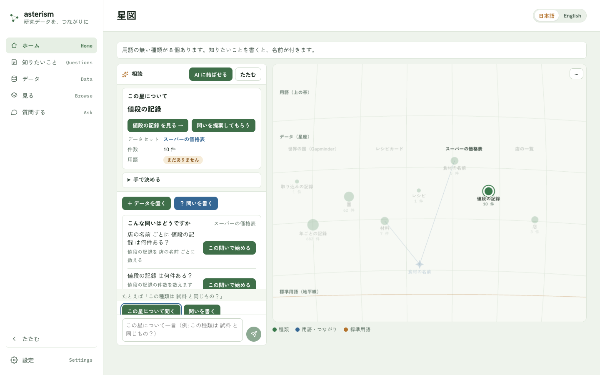
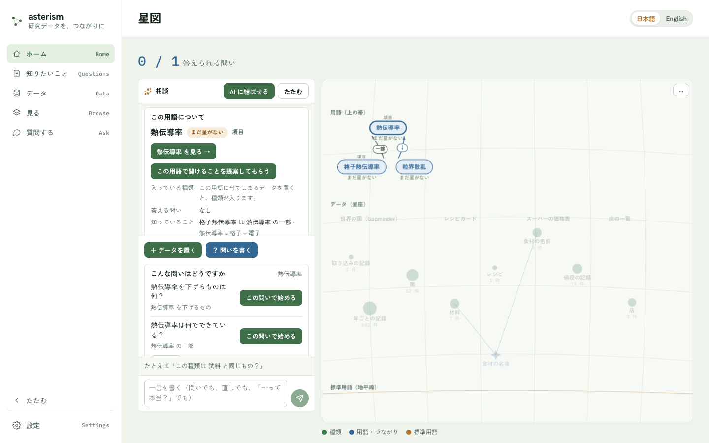

<!--
  Asterism マニュアル（人間向けヘルプ = AI 相談チャットの知識、単一の真実源）。
  getting-started.md の冒頭コメントに書いた表記規約（ボタンは「文言」ボタン、
  タブは「文言」タブ、サイドバーのメニュー項目はメニューの「文言」の形で書く
  こと）は本ファイルにも適用される。
  ファイル名は graph.md のまま。章は「星図」（ホーム＝作業場）。左に会話・右に星図（UI 再設計 PR 8b〜8c）。
  以前の「全体グラフ」は、星図の「中身まで見る」に入った。
-->

# 星図 — 左で話して、右の図が育つ

## ホーム（作業場）と星図

アプリを開いたときのホームは、左が AI との会話、右が星図の「作業場」です。星図は、公開したデータと、
知りたいこと（問い）が 1 枚の紙の図になったものです。「今あるデータで、どの問いに答えられるか」を
ひと目で見るためにあります。

| 図の中のもの | 描きかた |
|---|---|
| 種類 | 緑の星。大きさは件数（表示中の最小〜最大の対数で、面積に比例）。名前は星の下、件数はその下 |
| データセット | 星座。中の種類を細いつなぎで結び、名前を添えます（枠は引きません） |
| 用語 | 上の帯の青い札。種類から札へ矢印が伸び、「〜の一種」は矢じり付き、「同じもの」は矢じり無し。星がまだ無い用語は薄い青で「まだ星がない」と出ます |
| 標準用語 | 下の帯（地平線）の琥珀色の札。用語の札の下に「≡ cmso:Material」のような小さな字が出ます |
| つながり | 星座のあいだにある青い 4 つ角の星。参加している種類へつなぎが伸びます |
| 提案 | 上の帯に「提案」の印つきで薄く重なる札と矢印。「図に入れる」と濃くなります |

同じデータからは、いつも同じ絵が描かれます。データセットは公開の古い順に並び、新しく公開したデータセットは
最後に加わります。すでにある星座の位置は動きません。

## 左の会話で図を育てる

会話の先頭に、最初の一手のチップが 2 つあります。

- 「＋ データを置く」ボタン — 右にかんたんモードが開きます（[データの追加](./add-data.md)）
- 「？ 問いを書く」ボタン — 知りたいことを 1 行書くと、AI が答えに要る種類・項目・関係の下書きを返します
  （[知りたいこと](./vocab-and-grounding.md)）

AI の返事は、星図の上の帯に「提案」の印つきで薄く重なり、会話には**提案カード**が出ます。カードの返事は 3 つです。

| 返事 | 起きること |
|---|---|
| 「図に入れる（N 件）」 | 提案が濃くなり、図の一部になる（まだ保存はされない） |
| 「入れない」 | 提案を外す。同じ内容は次から出ない |
| 「1 件ずつ選ぶ」 | 行ごとに「これは図に入れる」「これは入れない」を選ぶ |

返事を決めるまで、図は変わりません。図に入れたものを保存するのは、会話の下の置くボタン（「N 件を置く」と出る）です
（押す前に、置く内容の一覧と ID を確かめられます）。会話の文は保存されず、残るのは図に入れたものと、
理由・誰が決めたかの記録だけです。

## 関係を直す

- 提案の矢印を押すと、会話の先頭に「A・関係・B」の札が出ます。プルダウンで選び直し、「直す」ボタンで反映します。
  「この関係を外す」ボタンで外せます。
- 矢印の端の丸を持って別の札に落としても、同じように付け替えられます。
- 提案の札を押すと「ここを広げる」ボタン（AI がその周りを足す）と「外す」ボタンが出ます。
- 「手で決める」ボタン — 星を選んだときに出る、AI を使わない決め方です（用語に「の一種」「と同じもの」で結ぶ）。

## 名前の一致の提案・AI に結ばせる

- 公開したデータの名前が、用語の名前と完全に一致すると、会話の先頭に「結べそうな線が N 件 →」が出ます
  （機械が数えたもので、AI は使いません）。星図には提案の矢印として重なります。置くボタン（「N 件を置く」と出る）でまとめて、
  「1 件ずつ選ぶ」ボタンで選んで、「結ぶ」か「入れない」を返します。
- 「AI に結ばせる」ボタン — 用語にまだ結ばれていない種類を、AI が用語に結ぶ提案にします。押したときだけ動き、
  「図に入れる」を返すまで何も保存しません。

## 星を選ぶ

星・用語・標準用語・つながりを押すと、会話の先頭に札が出ます。

- **この星について** — 主ボタン「◯◯ を見る →」（その種類のページ＝[見る](./workspace.md)）、データセット、件数、
  入っている用語。この種類に掛かる決めたことがあれば「決めたこと N 件 →」から一覧に入れます。
- **この用語について** — 入っている種類・答える問い・「知識 N」（確定した関係で答える数）・標準用語。
- 星を選んでいるあいだは、入力欄の上に送り先の切り替えが出ます。「この星について聞く」ボタン（その星への相談）と
  「問いを書く」ボタン（新しい問い）。

公開した直後と、決めた直後に答えられる問いが増えたときは、会話の先頭に「答えられる問い 5 → 6」が数秒だけ出ます。
かんたんモードで公開を終えて閉じると、公開した種類の星が 1 度だけ灯ります（リロードしても繰り返しません）。

## 見かた

- 上に「N / M 答えられる問い」（M 個の問いのうち、答えるデータがある問いが N 個）。図の下の 1 行にも同じ数と
  「テーマを見る →」があります。
- 図の下の 1 行は凡例です（● 種類　● 用語・つながり　● 標準用語）。
- 点（星・札・丸）にマウスを載せると、その点につながるものだけが濃くなり、ほかは薄くなります。
- 名前は、重ならないものだけが出ます。件数の多い星の名前から先に出ます。
- 種類が 60 を超える、またはデータセットが 8 を超えると、データセットを 1 つの丸にまとめます。
  丸の大きさはデータセットの件数で、押すと中の種類が会話の札に出ます。

## 問いを提案してもらう

問いを自分で書く前に、AI に「こんな問いはどうですか」と案を出してもらえます。次の 2 か所にボタンがあります
（どちらも **AI が設定されているときだけ**出ます。[設定](./settings.md)）。

- **星の札の「問いを提案してもらう」** — 種類の星（公開済みのデータ）を選んだときの「この星について」の札。
  その表の列の見出しから、聞きたくなりそうな問いを出します。
- **用語の札の「この用語で聞けることを提案してもらう」** — 答える問いが 1 つも無い用語を選んだときの札（用語の
  ページの「使う問い」が空のときも同じボタン）。その用語の周りの関係から、答えられるはずの問いを 2〜3 本出します。
  すでに問いがある用語には出ません。図の「穴」を埋めるためのボタンです。

押すと、左の会話に「こんな問いはどうですか」のカードが出ます（3〜5 本）。1 行に問いの文と、その問いを機械が
どう数えるかの 1 文（薄い字）が並び、行ごとに「この問いで始める」ボタンがあります。

- 「この問いで始める」を押すと、その問いが「問いを書く」の入力欄に入った状態で書く流れに移ります。そこから先は
  ふだんの流れ（送る → 薄い下書きが図に重なる → 図に入れる → N 件を置く）です。下書きが開いているときは、
  切り替えてよいかを先に聞きます。
- 気に入る問いがなければ「閉じる」を押すだけです。**提案も、押さなかった問いも、どこにも残りません**。
- 出る問いは、機械が「答えられる形」に落ちるものだけです。列や用語に無い名前を使う問い、すでにある問いと
  重なる問いは出ません（「出せる問いが見つかりませんでした」と出ることがあります）。
- 提案から始めて置いた問いには、AI が下書きした印が付きます（用語のページの履歴で分かります）。

何を AI に渡すか、渡さないかは [知りたいこと](./vocab-and-grounding.md#問いは-AI-に提案してもらえる) に
まとめてあります。

## 育つ瞬間

かんたんモードで公開を終えた画面の「星図を見る」ボタンから星図に移ると、公開した種類の星が
1 度だけ灯ります（輪が広がります）。リロードしても繰り返しません。

## 「…」の操作 — 静かな表示・数・画像

図の右上の「…」を押すと、次の 4 つが出ます。

- 「静かな表示」— 灯る動きを止めます。選びはこのアプリに覚えられます。OS の「視差効果を減らす」
  設定も同じに扱います。
- 「画像で保存」— いまの星図を PNG にして保存します（選びや濃淡は入りません）。
  デスクトップ版では保存に対応していません。ブラウザ版から保存してください。
- 「数で見る」— 種類・用語・データセット・事実の数と、図と同じ内容の表（星座・星・件数・用語・
  標準用語・知識の関係）を開きます（読み上げやコピー用）。
- 「中身まで見る」— 下の節の、値の網に移ります。

## 空のとき・AI が未設定のとき

- データも問いも無いとき: 見本の星図が薄く重なり、「問いを書くか、データを置くと、ここに図が育ちます」と出ます。
- データだけがあるとき: 「用語の無い種類が N 個あります」と出ます。問いを書くと、名前が付きます。
- 問いだけがあるとき: 「答えるデータがまだありません」と出ます。データを置くと、合う種類を探します。
- AI が未設定のとき: 会話の入力欄は閉じます。チップと札だけで進められます。「？ 問いを書く」は小さな書き込み欄になり、
  「手で書く」ボタンで手入力の下書きが始まります（概念は「手で足す」から足せます）。設定は
  [settings.md](./settings.md)。

## 狭い画面（375px）

会話は、図の下から出るシートになります。たたんでいるあいだは、選んだ札が図の下の帯に出ます。
会話の「たたむ」ボタンと、たたんだあとの「相談を開く」ボタンで出し入れします。

## 中身まで見る（値の網）

図の右上の「…」から「中身まで見る」を選ぶと、同じ場所に、公開したデータ全体を 1 枚の網として
見る画面が開きます（アドレスは `#/home?deep=1`。以前の `#/network` もここに着きます）。
星図が種類の設計図なのに対し、こちらは中身そのものの網です。「星図にもどる」で戻ります。

- 件（1 つ 1 つのデータ）と、件どうしのつながりが点と線になります。
- 地域や年のような、少ない種類の値を何度も使う項目は、その値も点になります。
  同じ値を使う件が、その点のまわりに集まります。
- 同じ相手にしかつながらない件が 20 件以上あれば、1 つの束にまとめます
  （たとえば測定点が 3,000 件あっても、束の点 1 つになります）。
- 取り込みの記録のような来歴の線は、はじめは出しません。

### 見かた

- 上の一行は、件の数から点と線がいくつになったかの集計です
  （例: 件 3,800 → 点 776（値 25・束 2）・線 1,497）。
- 点の色は種類ごとに決まっていて、データが増えてもほとんど変わりません
  （ほかの種類と色がぶつかったときは、隣の色になります）。
  色が付くのは 8 種類までで、残りは灰色です。図の下の凡例で種類を押すと、
  その種類だけに色が付き（8 種類まで）、ほかは灰色になります。
  「色をすべてに戻す」で元に戻ります。

  

  値の点は濃い灰色、つながりのハブは青、束は大きめの丸で、中の件数が
  大きさになります。大きさはつながりの数で決まります。
- 名前が同じ種類は、凡例でデータセット名を添えて見分けます。選んだ点の帯にもデータセット名が出ます。
- 名前は、重ならないものだけが出ます。拡大すると細かい名前も出てきます。
  点にマウスを載せると、その点につながる線と相手がいったん濃くなり、名前も出ます。
- ホイールで拡大・縮小、ドラッグで動かせます。凡例は図の下にあります。

### 操作

- 点を押すと選べます。選んだ点につながる線と相手だけが濃くなり、ほかは薄くなります。
  何もないところを押すと選びを外します。
- 図の下の帯に、名前・種類・つながりの数が出ます。
  - 件とハブ: 「このページを開く」で、その 1 件のページへ移ります。
  - 値と束: 「一覧で開く」で、その値を持つ件（束なら束の中の件）の絞り込みの
    ページへ移ります。
- 「来歴の線も出す」を入れると、取り込みの記録などの線と点が加わります。
- 「名前で探す」に入力して「探す」ボタンを押すと、一致した点に寄って選びます。
- 右上のボタンで「大きく見る」ことができます。選びや拡大の状態はそのままです。
- 点が多すぎるときは「点が多いので一部だけ出しています」と出て、つながりの
  多い点から残します。

## 関連

- 種類だけの設計図は、データセットの詳細の「中身」タブの末尾の「ほかのデータセットとの関係の図」（[用語の地図](./vocab-and-grounding.md#用語の地図)）。
- 1 件から広げて見るのは[見る](./workspace.md)の「つながりを図で見る」。
