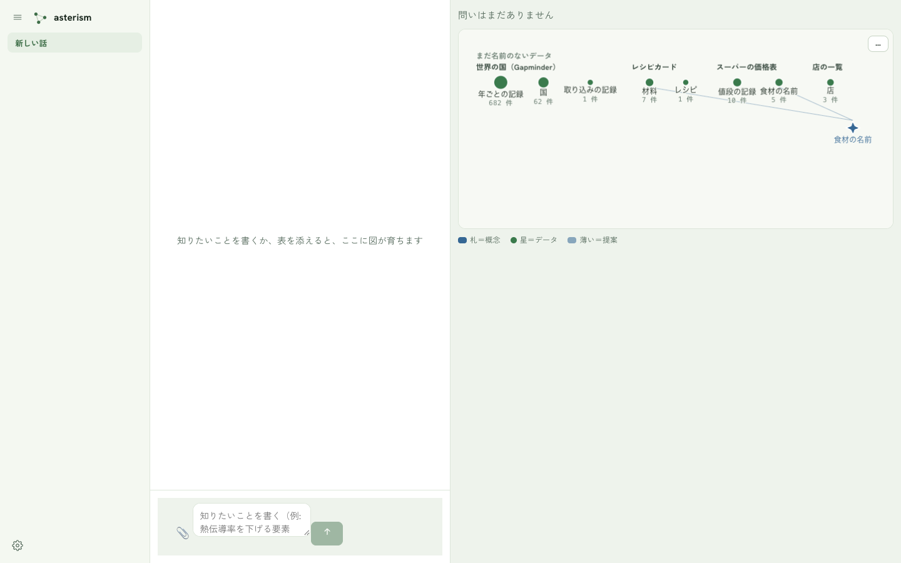

<!--
  Asterism マニュアル（人間向けヘルプ）。
  getting-started.md の冒頭コメントに書いた表記規約（ボタンは「文言」ボタン、
  タブは「文言」タブ、サイドバーのメニュー項目はメニューの「文言」の形で書く
  こと）は本ファイルにも適用される。
-->

# Asterism ユーザーマニュアル

Asterism は、研究データを「つながったデータ」にする道具です。チャットで知りたいことを話すと、AI が答えに要る知識を図に足し、
あなたが確かめて 確認で確定します。表や文書を添えると、データも同じ流れで公開できます。
公開したデータには、ふつうの言葉で質問でき、答えには出どころが付きます。公開するまで、データは誰にも見えません。

画面は 3 領域だけです。

| 領域 | 役割 |
|---|---|
| 左: チャットの一覧 | 話（1 つの知りたいこと）を溜めておく。たためる |
| 中央: チャット | 話す・質問する・表を添える（クリップ）・確認で確定する |
| 右: 地図 | 用語（青）とデータの種類（緑）の全体の地図と、このチャットの図の図。薄い＝提案、濃い＝確認済み |

たとえば熱電材料なら「ZT が最も高い試料の組成は？」、献立なら「にんじんを使うレシピは？」が、そのまま話の始まりになります。
狭い画面（375px）では、チャットと図がタブになります。

## はじめに

| 章 | 内容 |
|---|---|
| [はじめる](./getting-started.md) | 話を書く → 返事 → 確認、クリップで表を添えて公開する。まずここから |
| [画面別の導線リファレンス](./screens.md) | 3 領域と、操作の場所 |

## 使う

| 章 | 内容 |
|---|---|
| [図](./graph.md) | 地図と、このチャットの図・薄いと濃い・点を押す 1 枚・「…」 |
| [質問する](./ask.md) | 同じチャットで「…答えて」。出どころつきで答える |
| [話・用語・標準用語](./vocab-and-grounding.md) | チャット＝テーマ・用語・9 つの関係・標準用語 ≡ |
| [見る](./workspace.md) | 点を押して中身を見る・「…を見せて」で表 |

## データを育てる

| 章 | 内容 |
|---|---|
| [データの追加](./add-data.md) | クリップで添える・対応しているファイル・文書の取り込み |
| [データセットの管理](./datasets.md) | 公開・見直し・削除 |
| [つながり](./crosswalk.md) | 別々のデータを共通の値でつなぐ仕組み |

## しくみを知る

| 章 | 内容 |
|---|---|
| [つながったデータの基礎](./rdf-basics.md) | RDF・IRI・クラス・属性・オントロジー・SPARQL の関係 |
| [データセットの中のファイル](./dataset-files.md) | 変換ルール・仕様・検索タグ・設計書が何をしているか |

## そばに置く

| 章 | 内容 |
|---|---|
| [相談チャット](./consult.md) | 設計中の疑問を、チャットで聞く |
| [設定](./settings.md) | ⚙・AI の登録・言語・利用許可コード・使用量・保存先 |
| [デスクトップ版](./desktop.md) | 手元の PC で完結して使う・自動更新 |

## 困ったときは

- 操作の場所がわからない: [画面別の導線リファレンス](./screens.md)
- AI が答えない・書けない: ⚙ の「AI」タブで AI を登録します（[設定](./settings.md)）

## 更新を知る

| 章 | 内容 |
|---|---|
| [機能ロードマップ](./roadmap.md) | 「できること」が変わった節目だけを、版の順に |
| [リリース履歴](./release-history.md) | すべてのリリースと、そこに入った変更の一覧 |
