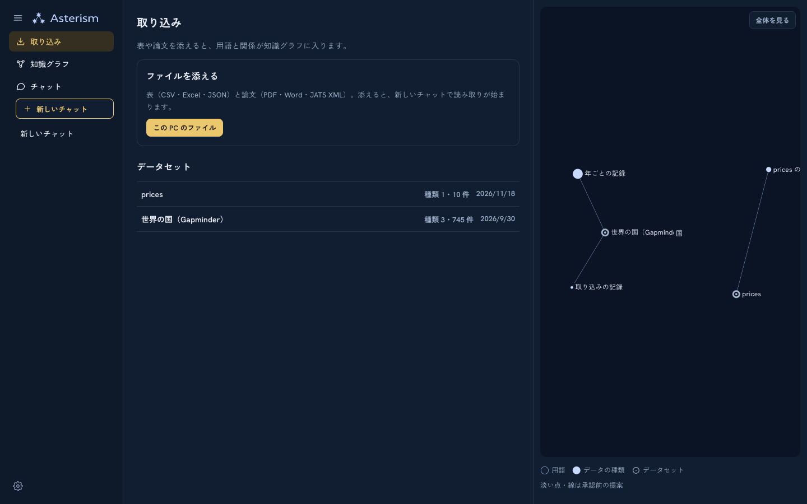

<!--
  Asterism マニュアル（人間向けヘルプ）。
  getting-started.md の冒頭コメントに書いた表記規約（ボタンは「文言」ボタン、
  タブは「文言」タブ、サイドバーのメニュー項目はメニューの「文言」の形で書く
  こと）は本ファイルにも適用される。

  このファイルと getting-started.md だけが相談チャットのプロンプトに注入される
  （ADR design-consult-chat.md §3.8 の基本セット）。新しい機能の章を足したら、
  ここにその導線を 1〜2 行で足すこと — 詳細は各章に、場所はここに。
-->

# 画面別の導線リファレンス

操作の場所をまとめます。詳しい使い方は、各節の章へのリンクを参照してください。

## 左のナビと 3 つの場所 <Badge type="tip" text="v0.68.0 (2026-11-18) で追加" />

画面の左に、ナビが 3 つあります。「取り込み」「知識グラフ」「チャット」です（この順）。押すと、その場所に移ります。
チャットの一覧は「チャット」の下にあり、どの場所にいても見えます。左下の ⚙（設定）は今までどおりです。「チャットの一覧を開閉」でたたむと、アイコンだけになります。

| 場所 | 中央 | 右 |
|---|---|---|
| 取り込み | 「ファイルを添える」（「この PC のファイル」。取り込み元を設定していれば「〈サーバ名〉 のファイル」も）と、「データセット」の一覧 | 知識グラフ（全体の図） |
| 知識グラフ | 絞り込み（取り込み元・状態・関係）と知識グラフ（大きく） | 取り込んだ知識の一覧（タブ「関係」「用語」「候補」。確認・違う・関係を付ける）。点を押したときは、その 1 枚と「関係」「データ」「問い N / M」が一覧の上に出る |
| チャット | 入力欄（1 つの丸い枠。📎 で表を添え、丸い送るボタンか Enter で送る。Shift+Enter で改行）。人の文は右の吹き出し、AI の文は地の文。知識グラフへの提案は差し込みの札で、「承認」「公開」「取り消す」がある | 知識グラフ。その下に、押した点の 1 枚と「関係」「データ」「問い N / M」のタブ（「知識グラフ」の場所の右と同じ並び） |

- 知識グラフは、○ 輪郭円＝用語・● 塗り円＝データの種類・「(提案)」付き＝承認前です。「関係」「データ」は、押した点について言っていることの行と、実際の行の表です。「値のつながり」はデータの右上にあります
- 最初に開く場所は、データセットもチャットも無ければ「取り込み」、あれば最後にいた場所です（覚えが無ければ、チャットがあるときはチャット、無ければ取り込み）
- 「取り込み」でファイルを選ぶと、新しいチャットが作られて「チャット」に移り、そこで読み取りの返事と承認が出ます。データセットの行を押すと「知識グラフ」に移り、そのデータセットが選ばれます
- 「知識グラフ」で、関係の「削除」「修正」「承認」や問いの「回答」を押すと、「チャット」に移って続きます。点の 1 枚の「データを見る」は、どの場所でも、右のタブを「データ」に切り替えるだけです
- 画面の URL は `#/import`・`#/graph`・`#/chat`・`#/chat/<id>`・`#/settings` です

狭い画面（980px 以下）では、ナビは下の 3 つのタブ（取り込み・知識グラフ・チャット）になり、場所ごとに 1 列で出ます。「チャット」はチャットだけで、チャットの一覧は上の ≡ で開きます。知識グラフと問いは、下のタブ「知識グラフ」で見ます。

## チャットの見かた

| もの | 見え方 |
|---|---|
| あなたの文 | 右寄せの吹き出し。表を添えたときは、クリップの印と名前が付く |
| AI の文 | 吹き出しの無い地の文。考えている間は 3 つの点 |
| 知識グラフへの提案 | 文の下の札。上の行は「知識グラフへの提案 · N 件」（承認後は「承認済み · 日時」、取り消すと「取り消し済み」）、下の行は「承認」（表を公開するときは「公開」）と「取り消す」 |
| 入力欄 | 1 つの丸い枠。書くほど行が伸びる。左下の 📎 で表を添え、右下の丸い送るボタンで送る。枠の下に「Enter で送る・Shift+Enter で改行」 |

## 知りたいことを話す

入力欄に書いて送ると、AI が問い・用語・関係を知識グラフに薄く足します。返事の「承認」で濃くなります
（[はじめる](./getting-started.md)）。

## 間違いを直す・取り消す

- 直す: 「店を削除して」のように書きます。または、知識グラフの「関係」のタブの行で「削除」「修正」を押します（「修正」は入力欄の上に対象の札が付き、その文の周りだけが直ります）
- 取り消す: 「さっきのを取り消して」と書くか、返事の「取り消す」を押します
- 承認済みの点を押して「削除」を押すと、削除の提案になります（承認で確定）

## 表や文書を添える

左の「取り込み」の「ファイルを添える」か、チャットの入力欄の 📎 で表を添えます（入口はどちらでも同じです）。返事の「公開」で公開されます（[データの追加](./add-data.md)）。
AI が未設定のときは、表を添えると「取り込み」の中央にかんたんモードが開きます（[はじめる](./getting-started.md#AI-未設定のとき)）。

## 公開したデータに質問する

同じチャットに「スーパーの価格表には何件ある？ 回答して」のように書きます。答えには出典が付きます（[質問する](./ask.md)）。

## 点を押す・データを見る

知識グラフの丸を押すと、右の列に 1 枚が出て（名前・来歴・データを見る・削除。「知識グラフ」では右の上、「チャット」では知識グラフの下）、その下の「関係」「データ」も変わり、入力欄の上に対象の札（「対象: 〈名前〉」）が付きます。「値段の記録を見せて」と書くと表で返ります
（[知識グラフ](./graph.md)・[見る](./workspace.md)）。

## 値のつながり

「データ」の見出し行の右上にあります。値でつなぐ網に移ります（[知識グラフ](./graph.md)）。

## 使う AI（プロバイダ）・言語・利用許可コード・使用量

左下の ⚙ を開きます（どの場所からでも開けます）。「AI」タブで使う AI（Anthropic / OpenAI / Google Gemini / OpenAI 互換 / GitHub Copilot など）と鍵を登録し、
「このサーバ」タブで利用許可コードを貼ります。言語（日本語・English）も設定の中にあります。
「AI の使用量」タブで使ったトークンと概算コスト、「このアプリ」タブでバージョンと更新の確認ができます
（[設定](./settings.md)・[desktop.md](./desktop.md)）。

## 別のデータセットとのつながり

別々のデータの同じ値は、公開のときに結ばれます。画面はなく、チャットで「…を見せて」と頼みます（[つながり](./crosswalk.md)）。

## 設計中の疑問をその場で聞く

専用の相談画面はありません。チャットに書きます（[相談チャット](./consult.md)）。

## 設計を見直す

公開した表の設計を直したいときは、同じ表をもう一度添えます（「取り込み」か 📎）。取り込んだ未公開の表が合わないときは、その返事の「取り消す」を押します
（[データセットの管理](./datasets.md)）。

## 関連

話の流れそのものは [getting-started.md](./getting-started.md) を、マニュアル全体の目次は
[index.md](./index.md) を参照してください。
