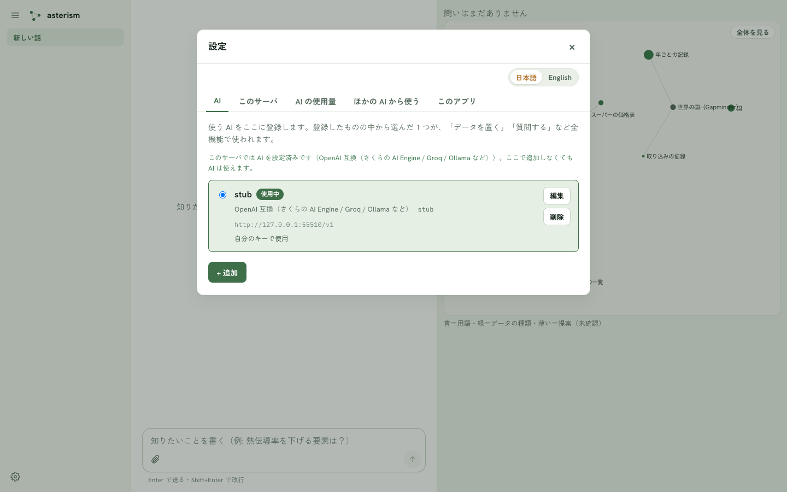
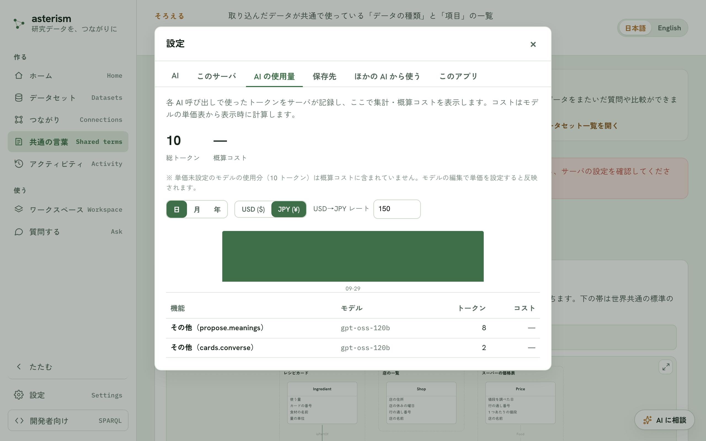
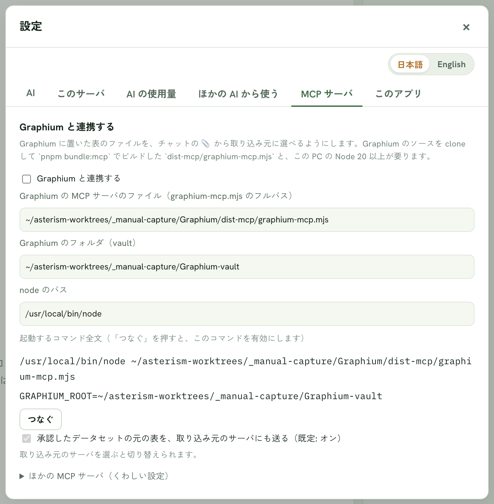
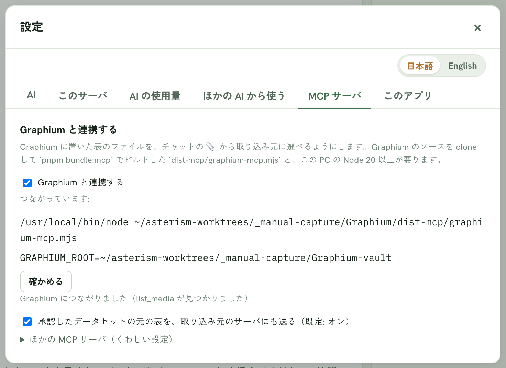

<!--
  Asterism マニュアル（人間向けヘルプ = AI 相談チャットの知識、単一の真実源）。
  getting-started.md の冒頭コメントに書いた表記規約（ボタンは「文言」ボタン、
  タブは「文言」タブ、サイドバーのメニュー項目はメニューの「文言」の形で書く
  こと）は本ファイルにも適用される。
-->

# 設定 — AI・利用許可コード・保存先

## 設定の開き方

左のチャットの一覧の下にある ⚙ を開くと、タブに分かれた設定画面になります。言語（日本語・English）の切り替えも、設定の中にあります。

## 「AI」タブ <Badge type="tip" text="v0.7.0 (2026-07-14) で追加" />

使う AI をここに登録します。登録した中から選んだ 1 つが、チャットの返事・
クリップでの取り込み・質問など全機能で使われます。プロバイダは次から選べます。

| プロバイダ | 必要なもの |
|---|---|
| Anthropic (Claude) | Anthropic の API キー |
| OpenAI | OpenAI の API キー |
| Google Gemini | Google AI Studio で作った API キー（アドレスの入力は不要） |
| OpenAI 互換（さくらの AI Engine / Groq / Ollama など） | エンドポイント（base URL）と、必要ならキー |
| GitHub Copilot（サブスク） | Copilot のプランと、このパソコンに入れてログイン済みの `copilot` CLI。キーは不要。デスクトップ版だけ |

未設定のあいだ、チャットの入力欄は閉じ、図の下の「AI なしで足す」で進められます（[はじめる](./getting-started.md#AI-未設定のとき)）。

「モデル一覧を取得」ボタンで、接続先から使えるモデルの一覧を取り寄せられ
ます。サーバに既定のキーが設定済みのプロバイダは、キーを入力しなくても
そのまま使えます。「このブラウザに記憶する」をオンにするとキーは
localStorage に保存されて再読み込み後も残り、オフだとタブを閉じるまでの
sessionStorage のみになります。「このサーバのみんなで使う」を選ぶと、
キーはサーバに保存され、使う人が自分でキーを用意しなくても AI が使えるよう
になります（キーの中身は誰の画面にも表示されません）。トークン単価を
設定すると、使った分のコストを概算できるようになります。

### Google Gemini を使う <Badge type="tip" text="v0.55.0 (2026-10-20) で追加" />

プロバイダで「Google Gemini」を選び、Google AI Studio で作ったキー
（`AIza` で始まります）を貼ります。アドレスは決まっているので入力しません。
「モデル一覧を取得」で使えるモデルが出るので、1 つ選んで保存します。

### GitHub Copilot（サブスク）を使う <Badge type="tip" text="v0.55.0 (2026-10-20) で追加" />

すでに GitHub Copilot を契約しているなら、キーなしで使えます。このパソコンの
`copilot` CLI のログインを借りるので、使った分は Copilot のプランの枠に数えられ、
従量課金にはなりません。デスクトップ版（このパソコンだけで使う形）でだけ選べます。
共有サーバや、ブラウザだけで開いた画面には出ません。

1. ターミナルで `npm install -g @github/copilot` を実行して CLI を入れます。
2. ターミナルで `copilot` を実行し、`/login` と入力してログインします。
3. 「AI」タブでプロバイダに「GitHub Copilot（サブスク）」を選び、「モデル一覧を取得」を押します。
   選ばなければモデルは `auto`（Copilot におまかせ）になります。

「モデル一覧を取得」で CLI が見つからない、またはログインしていないと出たら、
上の 1 か 2 をやり直してください。Asterism は Copilot の内蔵ツール（ファイルを
書き換える・コマンドを動かすなど）を使わせず、文章を作らせるためだけに呼びます。

学校や研究機関に所属していれば、[GitHub Education](https://github.com/education) に
申し込むと Copilot Pro を無料で使えることがあります。承認されると、上の手順だけで
使えるようになります。

Claude のサブスクリプション（Pro / Max）を借りる使い方には対応していません。
Anthropic の規約が、ほかのアプリからの利用を認めていないためです。Claude を使う
ときは API キーで登録してください。

### 適性を調べる

登録したモデルの行に「適性を調べる」ボタンがあります。押すと、Asterism が AI に求める
作業（形・振り分け・対象の遵守）を固定の問いで試し、約 40 回の呼び出しで 2〜3 分かかります。
進みは「調べています n / 40」と出ます。

- 結果は「推奨」「条件つき」「非推奨」のバッジと、形・振り分け・対象の率で出ます。まだ調べていないモデルは「未検査」です
- 「落ちた問を見る」で、落ちた問の番号と種類が分かります
- データも話も触らず、API キーは保存されません
- 判定の基準と、検査で測れないこと（知識）は [AI の要件](./ai-requirements.md) にあります

## 「このサーバ」タブ <Badge type="tip" text="v0.7.0 (2026-07-14) で追加" />

データの取り込み・公開などの書き込み操作には、このサーバの利用許可コードが
必要です。欄に貼り付けると、このタブを閉じるまで有効になります。
コードが無いとき、チャットの入力欄の位置に「設定 › サーバで鍵を入れると、話せます」と出て、チャットの一覧にも保存できない旨が出ます。
⚙ から貼り付けると、話せるようになります。貼り付けた
コードが正しいかは「もう一度確かめる」ボタンで検証できます。

同じタブの「ID の発行元」では、新しいデータセットの ID が作られるアドレス
を確認できます。お試しに使うだけなら仮のアドレスのままで十分ですが、公開した
あともずっと引用できる ID にするには、サーバ側でこのアドレスを設定します。

## 「AI の使用量」タブ <Badge type="tip" text="v0.7.0 (2026-07-14) で追加" />

各 AI 呼び出しで使ったトークン数の集計と、概算コストを確認できます。日・月・
年の粒度で切り替えられ、機能（質問する・設計の提案など）× モデルの内訳も
見られます。トークン単価を設定していないモデルの使用分は、概算コストには
含まれません。GitHub Copilot（サブスク）の行は従量課金がないので、コストの欄に
「サブスク（従量課金なし）」と出て、金額は計算しません。

## 「ほかの AI から使う」タブ <Badge type="tip" text="v0.23.0 (2026-08-28) で追加" />

Asterism に取り込んだデータを、Claude Code・Claude Desktop・Cursor・VS Code
などの AI から直接聞けるようにするタブです（公開済みのデータセットに行を足す
こともできます。下の「AI からデータを追記する」）。データをコピーして渡すのでは
なく、AI に**接続先**（`http://127.0.0.1:8765/mcp` のようなアドレス）を教える
だけで、その AI が Asterism に問い合わせて答えます。

使っている AI を選ぶと、その AI に必要な手順と、貼り付ける内容が出ます。
「コピー」ボタンで写して、AI 側に貼り付けてください。接続先は起動のたびに
この画面で確認します（別のプログラムが同じ番号を使っていると、Asterism は
別の番号で起動するため）。

Asterism を起動している間だけ使えます。アプリを終了すると、AI からは
繋がらなくなります。

### AI からデータを追記する（`append_rows`）

接続した AI は、聞くだけでなく、**公開済みのデータセットに新しい行を足す**こと
もできます（ツール `append_rows`）。ほかの記録の道具（実験ノート・判断の記録
など）に書いたものを、AI が Asterism の形に直して渡す使い方です。

| 項目 | 内容 |
|---|---|
| 足せる先 | 承認して公開済みのデータセットだけ。データセットの設計は変わらず、行が増えるだけです |
| 渡すもの | データセットの id・設計で読むファイルの名前（例 `judgments.json`）・1 件 1 オブジェクトの行。子の表（例 `rule_terms.json`）は同じ 1 回に一緒に渡せます |
| 同じ行をもう一度 | 同じ内容の行は、もう一度送っても増えません（1 回分のまま）。内容を直した行は別の行として足されます（置き換えはまだできません） |
| 最初の 1 回 | 設計はこの画面の外で人が決めて承認します（チャットにファイルを添えて作る、または設計の見本を使う）。`append_rows` はその後の回だけに使います |
| 鍵 | この画面の接続先（同じパソコンの中）からだけ使えます。別の鍵の配布はありません |
| 直した・消した行 | `append_rows` では届きません。もう 1 つのツール `resync_rows` に**全部の行**を渡すと、元のファイルを置き直して取り込み直し、新しい版に差し替えます（id が同じなら知識グラフの名前は変わりません）。ふだんの同期はこちらを既定にし、`append_rows` は増分だけに使います |

ほかの道具と組み合わせる手順の見本は、リポジトリの
[`docs/examples/graphium/`](https://github.com/kumagallium/asterism/tree/main/docs/examples/graphium)
にあります（記録の道具 Graphium で書いた判断・規則・観察を、保存のたびに
Asterism へ足し、AI が検索して答えを Graphium に戻す 1 周）。
## 「MCP サーバ」タブ

ほかのアプリが出している MCP サーバを登録し、そのアプリが持つ**表のファイル**を
チャットの 📎 の**取り込み元**に選べるようにするタブです。デスクトップアプリ
（単一ユーザーモード）でだけ出ます。ブラウザから共有のサーバを開いているときは
出ません。

### Graphium と連携する

一番上の「Graphium と連携する」に ☑ を入れると、Graphium に置いた表のファイルを
チャットの 📎 から取り込み元に選べるようになります。

1. Graphium のソースを clone して `pnpm bundle:mcp` でビルドした
   `dist-mcp/graphium-mcp.mjs` のフルパスを入れます（Graphium のデスクトップ版には
   MCP サーバは同梱されていません）。
2. 「Graphium のフォルダ（vault）」は既定で `~/Documents/Graphium` が入っています。
   別の場所に置いているときは直します。
3. 「node のパス」は Asterism が探して入れます（この PC の Node 20 以上）。
   見つからなかったときはパスを入れてください。デスクトップ版の Asterism は
   Node を同梱しません。
4. 下に出るコマンド全文を確かめて「つなぐ」を押します。すぐに Graphium に繋いで
   「Graphium につながりました（list_media が見つかりました）」と出れば完了です。
   取り込み元のサーバ・道具の名前・「原本を送る」の設定も一緒に入ります。

☑ を外すと、Graphium の MCP サーバは無効になり、取り込み元の設定も外れます
（登録そのものは残るので、もう一度 ☑ を入れればすぐ戻ります）。

### ほかの MCP サーバを登録する（くわしい設定）

Graphium 以外の MCP サーバを使うときは、「ほかの MCP サーバ（くわしい設定）」を開きます。

1. 「名前」「方式」を決めます。方式は **stdio**（コマンドで起動する）か
   **HTTP**（アドレスに繋ぐ）です。
2. stdio ならコマンド・引数・環境変数を、HTTP ならアドレスを入れます。
3. 「追加する」で一覧に入ります。**追加しただけでは動きません。** 一覧に出る
   コマンド全文を確かめてから「有効」に ☑ を入れてください。
4. 「道具を見る」で、そのサーバが出している道具の一覧を確かめられます。

::: warning 設定に秘密は入れられません
API キーやトークンのような名前の環境変数は保存されません（設定ファイルに
秘密を書かない決まりです）。HTTP の認証ヘッダも受け付けません。認証が要る
サーバは今のところ登録できません。
:::

### 取り込み元を決める（くわしい設定）

「取り込み元のファイルを持つサーバ」で登録済みのサーバを 1 つ選び、そのサーバの
道具の名前（一覧・取得・追加）を入れます。「Graphium と連携する」で繋いだときは
ここも一緒に入っているので、触る必要はありません。ここで決めたサーバが、
チャットの 📎 の取り込み元になります。

「承認したデータセットの元の表を、取り込み元のサーバにも送る」は、この PC から
足した表の原本を取り込み元のサーバにも送るかどうかの設定です（既定: ☑）。

### 直近の呼び出し

このタブの一番下に、Asterism が MCP サーバを呼んだ記録（サーバ・道具・結果・時刻）
が出ます。ファイルの中身は記録しません。

## 「このアプリ」タブ <Badge type="tip" text="v0.13.2 (2026-08-14) で追加" />

このパソコンに入っているアプリそのものについての設定を、1 つにまとめた
タブです。インストールされているバージョンの確認と、更新の確認ができます
（詳しくは [desktop.md](./desktop.md)）。デスクトップ版では、同じタブの下に
「ローカル保存先」と「PDF の読み取り」も並びます。

### 保存先 <Badge type="tip" text="v0.17.4 (2026-08-20) で追加" />

データセット・グラフ・チャット・設定を保存するフォルダを確認・変更できます
（変更はデスクトップアプリのみ）。「変更…」ボタンから別の場所を選べます。
選んだ場所が同期フォルダ（Dropbox など）だと、複数端末から同時に開いた
ときに壊れることがあるため推奨されません。確認の画面で「今のデータを新しい
場所へ移す」にチェックを付けると、次の起動時にデータが移り、結果が画面に
表示されます（移行先のフォルダが空のときだけ移します）。チェックを付けない
場合、既存のデータは自動では移動されないので、引き継ぎたいときはアプリを
終了してから旧フォルダの中身を新しいフォルダへ手動でコピーします。別の場所
を選んだあとは、「既定の場所に戻す」ボタンでいつでも元の保存先に戻せます。

### PDF の読み取り

デスクトップ版だけにあります。PDF を取り込むには、PDF を読み取る部品
（約 1.7GB）をこのパソコンに入れます。入れるのは 1 回だけです。

- 「部品を入れる」ボタンを押すと、ダウンロードが始まります。インターネットへの
  接続が要り、数分かかります。進み具合はこの欄に出て、設定の画面を閉じても
  続きます。途中でやめるときは「中止」ボタンを押します
- 入れ終わると「PDF を取り込めます」と出て、ファイルを置く欄が PDF を
  受け付けるようになります（画面を読み込み直す必要はありません）
- PDF の読み取りはこのパソコンの中で行い、読み取りのために PDF を外へ送ることは
  ありません。部品がインターネットを使うのは、入れるときだけです
- 要らなくなったら「部品を消す」ボタンで消せます（取り込み済みのデータは
  残ります）

うまく入らなかったときや、入れた部品が動かなくなったときは、理由と「もう一度試す」
ボタンが出ます。それでも動かないときは、同じ場所の「部品を消す」ボタンで消してから
入れ直せます。

## 関連

設計について AI に相談したいときは [consult.md](./consult.md)、公開した
データへの質問は [ask.md](./ask.md) を参照してください。
