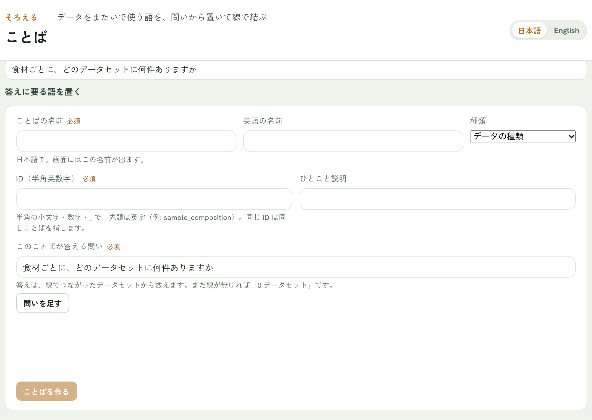
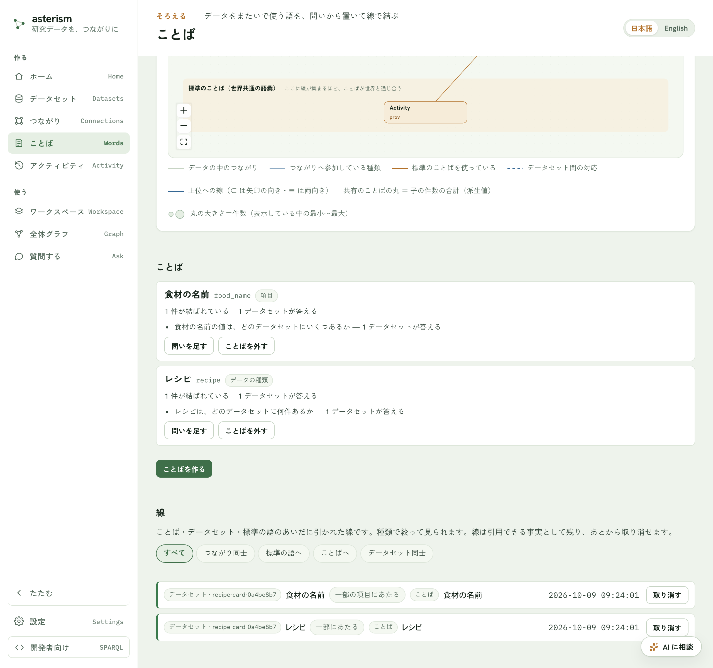

<!--
  Asterism マニュアル（人間向けヘルプ = AI 相談チャットの知識、単一の真実源）。
  getting-started.md の冒頭コメントに書いた表記規約（ボタンは「文言」ボタン、
  タブは「文言」タブ、サイドバーのメニュー項目はメニューの「文言」の形で書く
  こと）は本ファイルにも適用される。
-->

# 知りたいこと — 問いから用語を決める・ひとこと決める・標準用語に合わせる

## 用語とは

複数のデータセットをまたいで使う「データの種類」と「項目」の名前を、用語
と呼びます。用語には 2 通りあります。

- **取り込んだデータが使っている用語** — 各データセットの設計から自動で
  集まります。複数のデータセットで名前が揃っているほど、データをまたいだ質
  問や比較ができます。
- **人が作る用語** — 人が名前を付けて作る、実体を持たない用語です。個々の
  データは持たず、名前だけを持ちます。データセットや標準用語と関係を決めて
  初めて、質問に答えられるようになります。

人が作る用語は、**問いに答えるために**作ります。問いのない用語は作れませ
ん。

## 入口

メニューの「知りたいこと」から、次の 3 つが同じ画面で見られます。画面上部の
「？ 知りたいことを書く」ボタンからは、問いを書く欄が開いた状態で入れます。

- 問いを書く入口（「問いから始める」）
- 用語の地図
- 用語の一覧（用語を作る・用語に種類を入れる）

人が決めた関係の一覧は、左下のメニューの「決めたこと」にあります
（[下の「決めたこと」](#決めたこと)）。「知りたいこと」の画面の用語の一覧の下には、
そこへの「決めたこと →」の 1 行だけが出ます。

## 問いから始める <Badge type="tip" text="v0.53.0 (2026-10-14) で追加" />

画面の最初に「問いから始める」の節があります。知りたいことを 1 文で「問い」
に書き、答えに要るもの（データの種類・項目）を「答えに要る語を置く」で置い
ていきます。データがまだ無くても書けます。保存するときは、用語と問いを
いっしょに保存します。

問いが先でも、用語が先でも、「問いのない用語は作らない」ことは同じで
す。

### Ask からの持ち込み

Ask（質問する）で、問いに答えられなかったとき（答えが無かった回答の下）
は、「この問いに答えられるように、用語をつなぐ」ボタンでここへ来られます。
問いの題だけが持ち込まれ、答えに要る語はあなたが置きます（AI は使いません）。

## 用語を作る <Badge type="tip" text="v0.53.0 (2026-10-14) で追加" />

「用語を作る」で作ります。

1. **標準用語を先に探します。** 英語の名前（または取り込み時の列名）で標準
   用語の一覧から機械的に探します（AI は使いません）。合うものがあれば
   「この標準用語を使う」を選ぶのがはじめの選択です。選ぶと、用語は作り
   ません（書きかけの問いも保存されません）。データセットの詳細（「中身」タブ）で、
   種類・項目をその標準用語に合わせてください（[標準用語に合わせる](#標準用語に合わせる-任意)）。
   標準用語を照合している間は、「用語を作る」は押せません。
2. 標準用語を使わないときだけ、「使わずに新しく作る」を選び、理由を書きます
   （記録に残ります）。
3. 名前・ID（slug）・ひとこと説明を入れます。ID は半角英数字（小文字で始まり、
   英小文字・数字・アンダースコア）で、人が入れます。英語の名前や標準用語が
   あれば、それを元にした案が入ります。同じ ID の用語がすでにあるときは作れ
   ません（その用語を使ってください）。
4. **問いを 1 つ以上書きます**（必須）。作る画面の「問いを足す」で、保存す
   る前に問いを増やせます。作ったあとは、「知りたいこと」の一覧にある各用語の
   「問いを足す」から、あとで問いを足せます（題を書くと、問いの数え方は種
   類なら件数、項目なら値と決まっています）。

種類は「データの種類」か「項目」のどちらか一方です。

### まだ答えるデータがない（孤立の札）

作ったばかりの用語には「まだ答えるデータがない」の札が付きます。その用語
の問いに答えるデータセットがまだ 1 つも無い状態です。この間は、用語は一覧
と地図には出ますが、質問（Ask）や外部のツール（MCP）には出ません。関係が決ま
って答えられるデータセットができると、札は外れます。用語同士の関係だけでは
札は外れません。札の付いた用語が 20 個を超えると、一覧の上に注意が出ます
（作れる数の上限ではありません）。

### 用語を外す

「用語を外す」で外せます。関係が残っているときは外せないので、先にメニューの
「決めたこと」で、その用語への関係を取り消してください。

### この用語に種類を入れる（ひとこと決める）

用語の一覧の各行にある「この用語に種類を入れる」ボタン（項目の用語は「この用語に
項目を入れる」）で、データセットの種類・項目を選び、その 1 つについて
「ひとこと決める」ができます。名前が用語と完全に一致する種類は先頭に出ます。
「ひとこと決める」の見かたは次のとおりです。

1. 「「Sample」は [用語 ▾]」のように、決める相手の用語を選びます。
2. 次の 3 つから 1 つ選びます。**はじめは何も選ばれていません。**
   - 「の一種です」 — その種類（項目）は、用語の下位にあたる
   - 「と同じものです」 — 名前が違うだけで、同じもの
   - 「当てはまるものは無い」 — この提案を外す（次から出ません）
3. 選ぶと、その下に「そう決めるとどうなるか」が 1 行で出ます
   （例: 問い「回折点は、どのデータセットに何件あるか」に答えるデータセット 0 → 1）。
   この数え方では何も保存しません。結べない組み合わせ（種類と項目・循環・まだ作っていない
   用語）のときは、理由が出て「そう決める」は押せません。
4. 「そう決める」を押して初めて保存されます。「あとで決める」は何も保存せずに閉じます。

項目のときは「「A」の値は [用語 ▾] の一種です／と同じです」、量の種類を選んだときは
「この項目「A」の量は [量 ▾] です」の言い方になります。

## 用語の地図 <Badge type="tip" text="v0.40.0 (2026-09-02) で追加" />

「知りたいこと」画面の中に「用語の地図」が表示されます。データセットがつながる
ほど、この地図は育ちます。見せかたは「全体」（はじめの表示）と「詳しく」
の 2 つで、次の「「全体」と「詳しく」」で違いを説明します。以下の線（図に描かれる線）の説明
と集計は、おもに「詳しく」の表示のものです。

「詳しく」では、設計のあるデータセットの「種類」（箱）と「項目」（箱の
中）をひとつの図に重ねます。箱を押すと、そのデータセットの詳細ページに
移動します。図の下の帯は標準用語（世界共通の語彙）です。線は 4 種類
あります。

- 灰色の実線 — データの中のつながり（種類どうしの関係）
- 緑の実線 — 標準用語を使っている（確定）
- 琥珀の点線 — 標準用語の候補（名前がほぼ一致する標準用語。まだ確定して
  いません。候補は一覧から機械的に探すもので、AI は使いません）
- 青の点線 — データセット間の対応（「視点をつなぐ」で確定したもの）

なお、琥珀の点線は「詳しく」の標準用語の候補だけです。「全体」では、標準
用語を使っている（確定）線を琥珀の実線（細め）で描きます。

### 用語の帯と「関係を決める」 <Badge type="tip" text="v0.53.0 (2026-10-14) で追加" />

地図には、標準用語の帯の上に**用語の帯**が出ます（「全体」の
種類まで開いたときと「詳しく」。データセットごとの丸の段では描きません）。
種類の丸から用語へ向きのある線が、用語から標準用語へ
同じ意味の線が伸びます。丸の大きさは、つながっているものの件数の合計です
（派生した値です）。データセットが 0 件でも帯は描きます。配置は、同じ入力な
ら必ず同じになります。

地図で丸を 2 つ選ぶと「関係を決める」が出ます。小さなフォームで関係の種類を選んで確
定します。選べる関係は、2 つの端の種類で絞られます。その関係が答える問い
は、書いても書かなくても構いません。決めた関係は「決めたこと」の一覧に入ります。

図の上の集計（データセット・種類・項目・標準用語を使用・標準用語の候補・
対応）は、同じ内容を数字で表したものです。「全体」のときの集計は、全体図に
描いたもの（データセット・種類・つながり・標準用語・種類の件数の合計）
だけを数えます。

### 「全体」と「詳しく」 <Badge type="tip" text="v0.51.0 (2026-10-07) で追加" />

地図の上の「全体 ／ 詳しく」で見せかたを切り替えられます。はじめは「全体」です（選んだほうは次に開くときも覚えています）。

- **全体** — 種類を丸で描きます。丸が大きいほど、その種類のものが多く入っています。大きさは、いま図に出ている丸の中での比べです（図が変わると、同じ件数でも大きさが変わります）。件数は大きい丸なら丸の中に短く（「120万」など）、小さい丸なら名前の下に「820 件」と出ます。マウスを載せると正確な数が出ます。丸はデータセットの枠の中に並び、真ん中の丸は複数のデータセットをつなぐ「つながり」です。種類からつながりへ線が伸びます。標準用語は下の帯です。線は、間にある別の丸やその名前に重ならないよう、曲がることがあります。項目までは描きません。
  - **データセットが多いとき**（7 つ以上、または種類が合わせて 41 以上のとき）は、丸が種類ではなく**データセット**になります。丸の大きさは種類の件数の合計（図の中での比べ）で、件数は丸の中に、名前の下には「N 種類」と出ます（小さい丸は名前の下に「N 種類・M 件」）。真ん中の帯が「つながり」で、データセットはその上と下に並びます。線はデータセットからつながりへ 1 本ずつ（線に載せると「N 種類が参加」と出ます）。

    

  - その丸（またはつながり）を**押すと、その周りだけが種類の丸で開きます**。ほかのデータセットは、つながりに参加している種類だけが出て、枠に「ほか N 種類」と書かれます。参加者が多いときは、上の帯に「ほか N 個のデータセットは省いています」と出て、数の多い順に一部だけが描かれます。上の「全体に戻る」を押すと元の図に戻ります。

    

  - 丸やつながりに**マウスを載せる**と、そこにつながる線が濃くなり、ほかの線は薄くなります。
- **詳しく** — 種類を箱で描き、箱の中に項目を並べます。項目が標準用語に合っているか（使っている・候補・対応）まで見られます。

どちらの表示も、右上のボタンで窓いっぱいに広げて見られます（広げた中ではホイールで拡大縮小・Esc で戻る）。

「全体」（データセットが少ないとき、または周りを開いたとき）で丸を押すとその種類のページ、枠の名前のあたりを押すとそのデータセット、真ん中のつながりの丸を押すと「つながり」の画面に移ります。「全体」の線は、灰の実線がデータの中のつながり、青い実線がつながりへの参加、琥珀の実線が標準用語を使っている種類、青の点線がデータセット間の対応です。

## 一覧の見方

一覧に並ぶのは、いま使われている用語です。データの種類は件数（その種類
のものが何件あるか）、項目は使用回数で表示されます。数えるのは公開済みの
データだけです。公開前の下書きは含まれず、公開すると集計に入ります。

それぞれの用語には、その用語を使っているデータセットの一覧も付きます。

## 決めたこと

メニュー（左下）の「決めたこと」に、人が決めた関係が **1 行 1 文** で並びます。
ここは「知りたいこと」「データセットの詳細」「かんたんモード」で決めたものの記録で、
関係は引用できる事実として残ります。

> 「Sample（Starrydata）」は「試料」の一種　2026-10-09　問い 2　［取り消す］

各行には、文（関係の中身）、両端の小さな札（データセット・用語・標準用語・つながり）、
日付、その用語が答える問いの数が出ます。上の絞り込みで、次の見方に切り替えられます。

| 絞り込み | 何が並ぶか |
|---|---|
| すべて | 決めたこと全部（新しい順） |
| 一種 | 「〜の一種」と決めたもの |
| 同じもの | 「〜と同じ」と決めたもの |
| 量 | 項目の量（何を測った列か）を決めたもの |
| 標準用語 | 標準用語に結んだもの |
| つながり同士 | 別々に作ったつながりが同じものを指しているという対応（ここで決めることもできます） |
| 切れている | 結んだ先が今は見つからないもの |

### 取り消す

「取り消す」を押すと、実行する前に「取り消すと、問い「…」に答えるデータセット 2 → 1」
のように帰結が出ます。「取り消す」でもう一度押すと取り消され、「やめる」で戻れます。
取り消した関係は、いつでも決め直せます。

### 切れている

結んだ先（データセットや用語）が今は見つからない関係は、琥珀色の行で
「切れている」と出ます。残してあるので、取り消しだけできます。

### 決められない組み合わせ

用語の結び先を循環させることはできません（すでに下にあるものを上に結ぶなど）。
まだ作っていない用語や、種類と項目を混ぜた関係も決められません。「ひとこと決める」では、
押す前に理由が出ます。

### アクティビティ

「決めたこと」画面の上のタブ「アクティビティ」に、いつ・何が・どれだけ取り込まれたかの
記録があります（従来の「アクティビティ」メニューはここに移りました）。

## 用語の名前を直す

用語の名前を直したいときは、そのデータセットを開いて「設計を見直す」ボ
タンから変更できます。複数のデータセットが共通で使う用語は、名前を変え
るとそれを使うすべてのデータの検索・回答に影響するので注意してください。

## 標準用語に合わせる（任意） <Badge type="tip" text="v0.5.0 (2026-06-15) で追加" />

自分のデータ専用の用語を、よく使われる標準用語（QUDT・schema.org
など）に結びつけることができます。合わせておくと、他のデータと自動でつな
がり、外部のツールや AI もそのまま理解できます。合わせるかどうかは任意で、
合わせなくても検索・引用はそのまま使えます。

## 合わせ方

データセットの「中身」タブを開き、候補から選びます。候補は標準用語の
一覧から機械的に探すもので、AI は使いません。英語のふつうの言い方（例:
temperature, crystal structure）でも検索できます。合わせたい候補が見つ
かったら「この標準に合わせる」ボタンで確定します。あとから解除することも
できます。

## この列は何を測っているか <Badge type="tip" text="v0.17.5 (2026-08-21) で追加" />

項目名を標準に合わせるのとは別に、「この列は何を測っているか」という問い
にも合わせられます。単位が手がかりになるので、項目名が略記でも見つかるこ
とがあります。合わせておくと、「熱伝導率を測った人」のようにデータをまた
いで横断的に探せるようになります。

## すでに使われている標準

データの中ですでに使われていた、よく知られた標準用語は、自動で検出さ
れて一覧に表示されます。あらためて合わせる操作をしなくても、最初から標準
に沿っている場合はそのまま表示されます。

## 関連

- データどうしをつなぐ話は [crosswalk.md](./crosswalk.md) を参照してくだ
  さい。
- 公開の流れは [getting-started.md](./getting-started.md) を参照してくだ
  さい。
