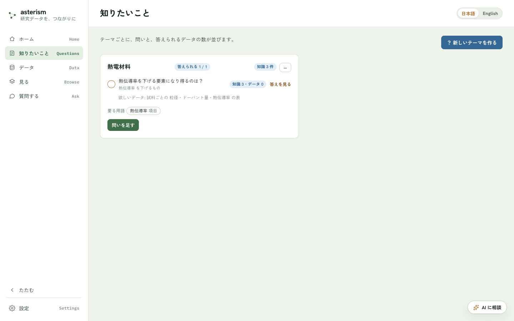
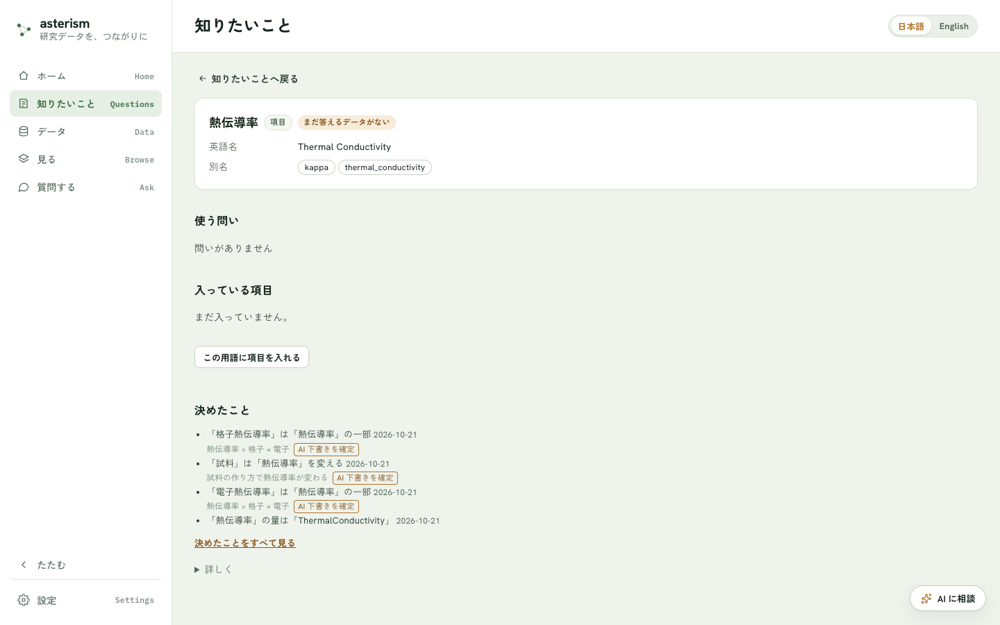
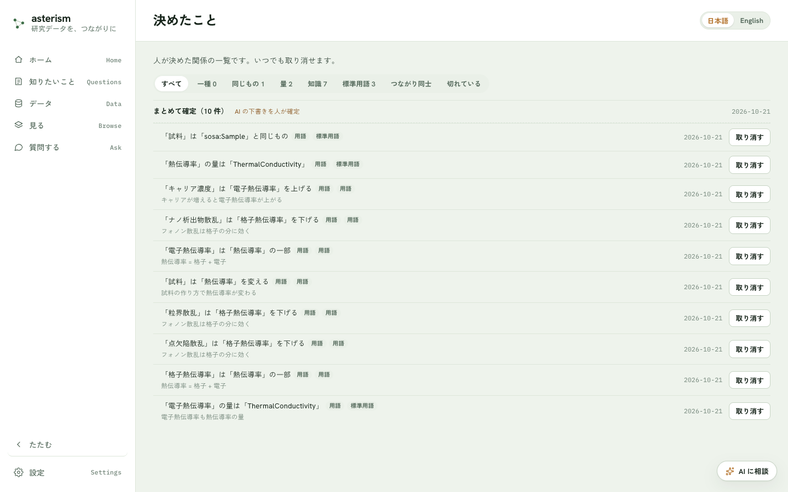

<!--
  Asterism マニュアル（人間向けヘルプ = AI 相談チャットの知識、単一の真実源）。
  getting-started.md の冒頭コメントに書いた表記規約（ボタンは「文言」ボタン、
  タブは「文言」タブ、サイドバーのメニュー項目はメニューの「文言」の形で書く
  こと）は本ファイルにも適用される。
-->

# 知りたいこと — 問いから育てる

## 用語とは

複数のデータセットをまたいで使う「データの種類」と「項目」の名前を、用語と呼びます。用語には 2 通りあります。

- **取り込んだデータが使っている用語** — 各データセットの設計から自動で集まります。複数のデータセットで
  名前が揃っているほど、データをまたいだ質問や比較ができます。
- **人が作る用語** — 問いに答えるために、人が名前を付けて作る、実体を持たない用語です（「概念」とも呼びます）。
  個々のデータは持たず、名前と関係だけを持ちます。

テーマの問いに関係でつながらない用語は作りません。用語は特定のテーマの持ち物ではなく、どのテーマからも
同じ用語を使えます。

## 知りたいこと（テーマの一覧）

メニューの「知りたいこと」を開くと、**テーマ**ごとのカードが並びます。テーマは問いのまとまりです。

- 問いごとの輪（答えるデータセットの数 ÷ 全体）と、問いの題・実行文（機械がその問いをどう数えるかの 1 文）
- 「知識 N・データ N」— 知識（確定した関係）で答えられる数と、データで答えるデータセットの数
- 要る用語（押すと[用語のページ](#用語のページ)へ）
- 「欲しいデータ: …」の 1 行（[下](#欲しいデータと型紙)）
- 公開しないメモの問い（「メモの問い N 件」に畳んであります）
- 主ボタンは「問いを足す」。「…」に「答えを見る（出典つき）」・「型紙を書き出す」・「テーマを外す」

この画面は**一覧**です。「？ 新しいテーマを作る」ボタンと「問いを足す」ボタンは、ホームの会話を「問いを書く」で開きます。
途中の下書きは「続きの下書き」に並び、「続ける」ボタンで続きから開けます（[星図](./graph.md)）。

## 問いを書いて、図に入れて、置く

作る操作は、ホームの作業場で 1 か所に集まっています。画面を離れずに、問いを書いてから置くまで進みます。

1. **問いを書く** — 会話の「？ 問いを書く」ボタンで、知りたいことを 1 行書きます（例: 「熱伝導率を下げる要素になり得るのは？」）。
   テーマの名前は任意です。空なら AI が付け、AI 未設定なら最初の問いの先頭 20 字になります。
2. **下書きが帯に出る** — AI が、答えに要る種類・項目（概念）と、あいだの関係、問いごとの答え方・欲しいデータを下書きします。
   星図の上の帯に「提案」の印つきで薄く重なり、会話には「AI の下書き（概念 M・関係 N）」のカードが出ます。
3. **相談しながら直す** — 「散乱因子は格子熱伝導率に紐づく気がする」のような一言を送ると、AI が差分の提案カードを返します。
   各行に理由が 1 行付きます。「入れない」と返した内容は保存され、次から出ません。矢印を押して A・関係・B を直す、
   「ここを広げる」ボタンで周りを足す、「手で足す」で自分で足すこともできます。
4. **図に入れる** — 「図に入れる」（全部なら「全部図に入れる」）で提案が濃くなります。「1 件ずつ選ぶ」で行ごとにも決められます。
5. **N 件を置く** — 会話の下の置くボタン（「N 件を置く」と出る）で、概念と関係と問いを**まとめて 1 回で**保存します
   （途中で失敗したら、置きかけたものは全部取り消されます）。図に入れていない提案は、置く対象に含まれません。

「N 件を置く」の前に、置く内容（新しい概念と ID・関係）の一覧が出ます。ID は半角の英小文字で始まり、英小文字・数字・
アンダースコアだけです。英語名から機械が案を作るので、確かめてください。すでに使われている ID や、同じ ID が 2 つあるときは
置けません。種類と項目を結ぶ・自分自身に結ぶ・一周する（循環）関係は、機械が止めて理由を出します。

### 9 つの関係

関係は決まった文で書きます。標準の述語を使い、独自のものは作りません（「一種」「同じもの」は種類どうしか項目どうしかで
述語が分かれるので、述語は全部で 9 つです）。

| 文 | 結べる組み合わせ |
|---|---|
| A は B の一種 | 同じ種別どうし（輪になる関係は不可） |
| A と B は同じもの | 同じ種別どうし |
| A の量は B | 項目 → 量の種類 |
| A は B の一部 | 同じ種別どうし（輪になる関係は不可） |
| A は B を下げる | 種類か項目 → 項目 |
| A は B を上げる | 同上 |
| A は B を変える | 同上（「下げる」「上げる」を含む） |

「下げる・上げる・変える」は、フィードバックの輪があっても構いません。

### 知識で答える・データで答える

問いごとの「答え方:」（例: 「熱伝導率 を下げるもの ▾」）で、答え方を選び直せます。

- **知識で答える** — 「〜を下げるもの」「〜を上げるもの」「〜を変えるもの」「〜の一部」「〜の一種」。確定した関係から、
  機械が決まった型で答えます（AI は答えを作りません）。「下げる」は、直接下げるものと、その一部が下げるものまで数えます。
- **データで答える** — 「〜の件数」「〜の〜の範囲」「〜の〜が最大」。データが答えます。
- **まだ決めない（メモ）** — 公開されません。

問いの横に「知識 N・データ N」が出ます。確定した関係が 1 本でもある用語は、データが無くても孤立と見なされません。質問する画面や
外部のツールには、「知識 5 件・データ 0 件」のように、誰がいつ決めたかつきで答えが出ます。あとからデータが置かれて列の名前が一致すると、
会話に「結べそうな線が N 件 →」が出て、返事をするとデータの数が増えます。

### 欲しいデータと型紙

各問いに「欲しいデータ: 試料ごとの 粒径・熱伝導率 の表」のような 1 行が付きます（論文の推薦は出しません）。
テーマの「…」の「型紙を書き出す」ボタンは、そのテーマが要る用語のうち、種類ごとに 1 つの CSV（見出し行だけ）を zip で書き出します。
先頭の列は `<種類>_id`、続く列は、その種類に結んだ項目の英語名（なければ ID）です。データから作るときの出発点になります。

### AI が未設定のとき

会話の入力欄は閉じます。「？ 問いを書く」は書き込み欄になり、「手で書く」ボタンで手入力の下書きが始まります
（設定は「設定」からいつでも）。概念は「手で足す」から、関係は A・関係・B を選んで足します。英語名の無い行の ID は
機械が仮に付け、置く前に直せます。それ以外は AI ありと同じ画面です。

### AI に渡すもの・書かせないもの

AI に渡すのは、問いの文と、すでにある用語・標準用語の**名前だけ**です（データの値は渡しません）。AI が返すのは決まった形の
下書きだけで、SPARQL・コード・IRI は書きません。名前や別名にそれらが混ざっていたら受け付けません。

### 来歴

置いた概念と関係には、「AI 下書き → 人が図に入れた」の印と日付、まとめて決めた ID、理由 1 行が残ります（AI の生の出力は
保存しません）。「決めたこと」と用語のページの履歴で読めます。人が手で足したものは「人が確定」と出ます。

### 標準用語・量の種類との関係

標準用語を選んだ概念は、その標準用語と「同じもの」として結ばれます（項目で、量の種類（QUDT）に一致したときは「量」の関係）。
名前が完全に一致した既存の用語は新しく作らず、それを使います（部分一致では当てません）。

### 別名

別名は、あとでデータを置いたとき、列名と突き合わせる手がかりです。かんたんモードの「意味をつける」で、列名や意味が別名に
**完全に一致**したときも、既にある用語の候補として「（別名 … が一致）」と出ます。

### メモの問い

データでも知識でも答え方が決まらない問いは、「メモの問い」として残ります。**公開されず**、質問（Ask）や外部のツール（MCP）にも
出ません。答え方を選び直すと、公開の問いにできます。

### 問いを足す・テーマを外す

テーマのカードの「問いを足す」ボタンで、ホームの会話が開き、置くとそのテーマに問いが加わります。「テーマを外す」ボタンで、
そのテーマと、ほかのテーマ・データが使っていない概念・関係が消えます（残したものの件数も出ます）。

### かんたんモード・質問する からの入口

かんたんモードの「ためす」で足した自分の問いは、「テーマに入れる」ボタンで、ほかのデータにも通じる用語の問いとして
写し、選んだテーマに入れられます（元の問いは残ります。上位に用語が無いときは案内が出ます）。質問する画面で答えられなかったときは、
「この問いをテーマに入れて育てる」ボタンで、題を持ち込んでホームの会話を開けます（AI は、あなたが送るまで使いません）。

## 問いは AI に提案してもらえる

問いを書く前に、AI に案を出してもらえます。ボタンは 3 か所です（AI が設定されているときだけ出ます）。

| ボタン | どこに出るか | AI が読むもの |
|---|---|---|
| 「問いを提案してもらう」 | ホームで種類の星を選んだ札。データを公開した直後の完了画面 | データセットの名前・列の見出しと型のヒント・何の行か（種類の名前）・すでにある問いと用語の名前 |
| 「この論文から問いを提案してもらう」 | 文書（論文）を取り込んだ直後と、そのデータの詳細 | 文書の**要旨と結論の文**（合計 2,500 字まで）・すでにある問いと用語の名前 |
| 「この用語で聞けることを提案してもらう」 | 答える問いが 1 つも無い用語の札と、用語のページの「使う問い」が空のとき | 用語の名前・種別・合わせた標準用語・周りの関係の文・入っている種類の名前 |

- **渡さないもの**: データの値（セルの中身）・論文の本文全体・PDF そのもの・あなたの ID や IRI。AI は列の
  見出しと名前だけで問いを考えます。そのため、問いの中の「SnSe を含む」のような語は、AI が文から写した
  もので、データの中身を見て当てたものではありません。
- **AI が書くもの**: 問いの文と、答え方（件数・範囲・上位・値で絞る・〜ごと・推移・結合・要因・一部・一種）の選択だけです。
  SPARQL・コード・IRI は書きません（そう見える文字列は機械が捨てます）。
- **機械が絞る**: AI の案のうち、答えられる形に落ちるもの、名前が列や用語に実在するもの、すでにある問いと
  重ならないものだけが「こんな問いはどうですか」のカードに出ます（最大 5 本）。メモの問いは増えません。
- **押すまで何も残らない**: ボタンを押したときだけ AI を呼びます（公開や取り込みの処理の中では呼びません）。
  カードの問いは保存されず、「閉じる」で消えます。「この問いで始める」を押すと、その問いが入力欄に入って
  [問いを書く流れ](#問いを書いて-図に入れて-置く)に移り、送って置くまでは何も保存されません。置いた問いには
  「AI が下書きした」印が付きます。

画面の見かたは [星図](./graph.md#問いを提案してもらう)・データを公開した直後と文書は
[データの追加](./add-data.md#問いを提案してもらう) にあります。

## 用語のページ

テーマのカードの用語の札や、ホームの用語の「◯◯ を見る」を押すと、その用語のページが開きます。

- 名前（英語名・説明があれば添えます）・別名
- 使う問い（どのテーマに入っているかも）
- 入っている種類（項目）— 「この用語に種類を入れる」ボタンで、データセットの種類・項目を結べます
  （[下](#この用語に種類を入れる-ひとこと決める)）
- この用語に関する**決めたこと**（[決めたこと](#決めたこと)）。「格子熱伝導率 は 熱伝導率 の一部」のような文に、理由と「AI 下書きを確定」の印が付きます。「決めたことをすべて見る」で一覧へ

ID と IRI、履歴（作った日。AI の下書きを人が確定したときは「AI の下書きを人が確定しました」とその日付）、「用語を外す」ボタンは、
いちばん下の「詳しく」を開くと出ます。関係が残っている用語は外せないので、先に「決めたこと」で、その用語
への関係を取り消してください。

### まだ答えるデータがない（孤立の札）

作ったばかりの用語には「まだ答えるデータがない」の札が付きます。その用語の問いに答えるデータセットがまだ 1 つも無い状態です。
ただし、人が確定した知識の関係が 1 本でもあれば、孤立とは見なされず、質問（Ask）や外部のツール（MCP）にも
「知識 N 件・データ 0 件」として出ます。関係もデータも無いあいだは、地図には出ますが、質問や外部のツールには出ません。
データが置かれて関係が決まると、札は外れます。札の付いた用語が 20 個を超えると、注意が出ます（作れる数の上限ではありません）。

### この用語に種類を入れる（ひとこと決める）

用語のページの「この用語に種類を入れる」ボタン（項目の用語は「この用語に
項目を入れる」）で、データセットの種類・項目を選び、その 1 つについて
「ひとこと決める」ができます。名前が用語と完全に一致する種類は先頭に出ます。
「ひとこと決める」の見かたは次のとおりです。

1. 「「Sample」は [用語 ▾]」のように、決める相手の用語を選びます。
2. 次の 3 つから 1 つ選びます。**はじめは何も選ばれていません。**
   - 「の一種です」 — その種類（項目）は、用語の下位にあたる
   - 「と同じものです」 — 名前が違うだけで、同じもの
   - 「当てはまるものは無い」 — この提案を外す（次から出ません）
3. 選ぶと、その下に「そう決めるとどうなるか」が 1 行で出ます
   （例: 問い「回折点は、どのデータセットに何件あるか」に答えるデータセット 0 → 1）。
   この数え方では何も保存しません。結べない組み合わせ（種類と項目・循環・まだ作っていない
   用語）のときは、理由が出て「そう決める」は押せません。
4. 「そう決める」を押して初めて保存されます。「あとで決める」は何も保存せずに閉じます。

項目のときは「「A」の値は [用語 ▾] の一種です／と同じです」、量の種類を選んだときは
「この項目「A」の量は [量 ▾] です」の言い方になります。

## 用語の地図 <Badge type="tip" text="v0.40.0 (2026-09-02) で追加" />

データセットの詳細（「データ」でカードを開く、または「見る」のデータセットのページの「詳しい情報」）の「中身」タブの末尾、「ほかのデータセットとの関係の図」を開くと、地図が表示されます。データセットがつながる
ほど、この地図は育ちます。見せかたは「全体」（はじめの表示）と「詳しく」
の 2 つで、次の「「全体」と「詳しく」」で違いを説明します。以下の線（図に描かれる線）の説明
と集計は、おもに「詳しく」の表示のものです。

「詳しく」では、設計のあるデータセットの「種類」（箱）と「項目」（箱の
中）をひとつの図に重ねます。箱を押すと、そのデータセットの詳細ページに
移動します。図の下の帯は標準用語（世界共通の語彙）です。線は 4 種類
あります。

- 灰色の実線 — データの中のつながり（種類どうしの関係）
- 緑の実線 — 標準用語を使っている（確定）
- 琥珀の点線 — 標準用語の候補（名前がほぼ一致する標準用語。まだ確定して
  いません。候補は一覧から機械的に探すもので、AI は使いません）
- 青の点線 — データセット間の対応（「視点をつなぐ」で確定したもの）

なお、琥珀の点線は「詳しく」の標準用語の候補だけです。「全体」では、標準
用語を使っている（確定）線を琥珀の実線（細め）で描きます。

### 用語の帯と「関係を決める」 <Badge type="tip" text="v0.53.0 (2026-10-14) で追加" />

地図には、標準用語の帯の上に**用語の帯**が出ます（「全体」の
種類まで開いたときと「詳しく」。データセットごとの丸の段では描きません）。
種類の丸から用語へ向きのある線が、用語から標準用語へ
同じ意味の線が伸びます。丸の大きさは、つながっているものの件数の合計です
（派生した値です）。データセットが 0 件でも帯は描きます。配置は、同じ入力な
ら必ず同じになります。

地図で丸を 2 つ選ぶと「関係を決める」が出ます。小さなフォームで関係の種類を選んで確
定します。選べる関係は、2 つの端の種類で絞られます。その関係が答える問い
は、書いても書かなくても構いません。決めた関係は「決めたこと」の一覧に入ります。

図の上の集計（データセット・種類・項目・標準用語を使用・標準用語の候補・
対応）は、同じ内容を数字で表したものです。「全体」のときの集計は、全体図に
描いたもの（データセット・種類・つながり・標準用語・種類の件数の合計）
だけを数えます。

### 「全体」と「詳しく」 <Badge type="tip" text="v0.51.0 (2026-10-07) で追加" />

地図の上の「全体 ／ 詳しく」で見せかたを切り替えられます。はじめは「全体」です（選んだほうは次に開くときも覚えています）。

- **全体** — 種類を丸で描きます。丸が大きいほど、その種類のものが多く入っています。大きさは、いま図に出ている丸の中での比べです（図が変わると、同じ件数でも大きさが変わります）。件数は大きい丸なら丸の中に短く（「120万」など）、小さい丸なら名前の下に「820 件」と出ます。マウスを載せると正確な数が出ます。丸はデータセットの枠の中に並び、真ん中の丸は複数のデータセットをつなぐ「つながり」です。種類からつながりへ線が伸びます。標準用語は下の帯です。線は、間にある別の丸やその名前に重ならないよう、曲がることがあります。項目までは描きません。
  - **データセットが多いとき**（7 つ以上、または種類が合わせて 41 以上のとき）は、丸が種類ではなく**データセット**になります。丸の大きさは種類の件数の合計（図の中での比べ）で、件数は丸の中に、名前の下には「N 種類」と出ます（小さい丸は名前の下に「N 種類・M 件」）。真ん中の帯が「つながり」で、データセットはその上と下に並びます。線はデータセットからつながりへ 1 本ずつ（線に載せると「N 種類が参加」と出ます）。

  - その丸（またはつながり）を**押すと、その周りだけが種類の丸で開きます**。ほかのデータセットは、つながりに参加している種類だけが出て、枠に「ほか N 種類」と書かれます。参加者が多いときは、上の帯に「ほか N 個のデータセットは省いています」と出て、数の多い順に一部だけが描かれます。上の「全体に戻る」を押すと元の図に戻ります。

  - 丸やつながりに**マウスを載せる**と、そこにつながる線が濃くなり、ほかの線は薄くなります。
- **詳しく** — 種類を箱で描き、箱の中に項目を並べます。項目が標準用語に合っているか（使っている・候補・対応）まで見られます。

どちらの表示も、右上のボタンで窓いっぱいに広げて見られます（広げた中ではホイールで拡大縮小・Esc で戻る）。

「全体」（データセットが少ないとき、または周りを開いたとき）で丸を押すとその種類のページ、枠の名前のあたりを押すとそのデータセット、真ん中のつながりの丸を押すと「つながり」の画面に移ります。「全体」の線は、灰の実線がデータの中のつながり、青い実線がつながりへの参加、琥珀の実線が標準用語を使っている種類、青の点線がデータセット間の対応です。

## 件数の数え方

用語の一覧の画面はありません。作ってある用語は、テーマのカードの札から[用語のページ](#用語のページ)で見ます。
用語を作るのはホームの作業場で、ここに作るフォームはありません。
データの種類は件数（その種類のものが何件あるか）、項目は使用回数で数えます。数えるのは公開済みの
データだけです。公開前の下書きは含まれず、公開すると集計に入ります。

## 決めたこと

人が決めた関係が **1 行 1 文** で並ぶ画面です。入口は、用語のページの「決めたことをすべて見る」と、
ホームで星を選んだときの「決めたこと N 件 →」の 2 つです（左のナビには出しません）。
「知りたいこと」「データセットの詳細」「かんたんモード」で決めたものの記録で、
関係は引用できる事実として残ります。

> 「Sample（Starrydata）」は「試料」の一種　2026-10-09　問い 2　［取り消す］

各行には、文（関係の中身）、両端の小さな札（データセット・用語・標準用語・つながり）、
日付、その用語が答える問いの数が出ます。「図に入れる」で決めたものは「まとめて確定（N 件）」の 1 行にまとまり、
「AI の下書きを人が確定」「名前の一致を人が確定」「人が確定」の印が付きます。行を開くと、1 件ずつ文と理由が読めます。上の絞り込みで、次の見方に切り替えられます。

| 絞り込み | 何が並ぶか |
|---|---|
| すべて | 決めたこと全部（新しい順） |
| 一種 | 「〜の一種」と決めたもの |
| 同じもの | 「〜と同じ」と決めたもの |
| 量 | 項目の量（何を測った列か）を決めたもの |
| 知識 | 「下げる・上げる・変える」「一部」など、知識の関係として確定したもの |
| 標準用語 | 標準用語に結んだもの |
| つながり同士 | 別々に作ったつながりが同じものを指しているという対応（ここで決めることもできます） |
| 切れている | 結んだ先が今は見つからないもの |

### 取り消す

「取り消す」を押すと、実行する前に「取り消すと、問い「…」に答えるデータセット 2 → 1」
のように帰結が出ます。「取り消す」でもう一度押すと取り消され、「やめる」で戻れます。
取り消した関係は、いつでも決め直せます。

### 切れている

結んだ先（データセットや用語）が今は見つからない関係は、琥珀色の行で
「切れている」と出ます。残してあるので、取り消しだけできます。

### 決められない組み合わせ

用語の結び先を循環させることはできません（すでに下にあるものを上に結ぶなど）。
まだ作っていない用語や、種類と項目を混ぜた関係も決められません。「ひとこと決める」では、
押す前に理由が出ます。

### 取り込みの記録

いつ・何が・どれだけ取り込まれたかの記録は、「データ」の上のタブ「記録」にあります
（従来の「アクティビティ」は、ここに移りました）。

## 用語の名前を直す

用語の名前を直したいときは、そのデータセットを開いて「設計を見直す」ボ
タンから変更できます。複数のデータセットが共通で使う用語は、名前を変え
るとそれを使うすべてのデータの検索・回答に影響するので注意してください。

## 標準用語に合わせる（任意） <Badge type="tip" text="v0.5.0 (2026-06-15) で追加" />

自分のデータ専用の用語を、よく使われる標準用語（QUDT・schema.org
など）に結びつけることができます。合わせておくと、他のデータと自動でつな
がり、外部のツールや AI もそのまま理解できます。合わせるかどうかは任意で、
合わせなくても検索・引用はそのまま使えます。

## 合わせ方

データセットの「中身」タブを開き、候補から選びます。候補は標準用語の
一覧から機械的に探すもので、AI は使いません。英語のふつうの言い方（例:
temperature, crystal structure）でも検索できます。合わせたい候補が見つ
かったら「この標準に合わせる」ボタンで確定します。あとから解除することも
できます。

## この列は何を測っているか <Badge type="tip" text="v0.17.5 (2026-08-21) で追加" />

項目名を標準に合わせるのとは別に、「この列は何を測っているか」という問い
にも合わせられます。単位が手がかりになるので、項目名が略記でも見つかるこ
とがあります。合わせておくと、「熱伝導率を測った人」のようにデータをまた
いで横断的に探せるようになります。

## すでに使われている標準

データの中ですでに使われていた、よく知られた標準用語は、自動で検出さ
れて一覧に表示されます。あらためて合わせる操作をしなくても、最初から標準
に沿っている場合はそのまま表示されます。

## 関連

- データどうしをつなぐ話は [crosswalk.md](./crosswalk.md) を参照してくだ
  さい。
- 公開の流れは [getting-started.md](./getting-started.md) を参照してくだ
  さい。
