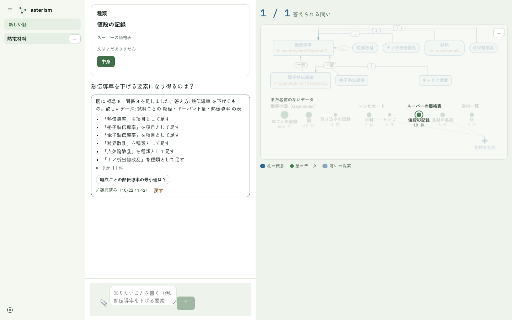
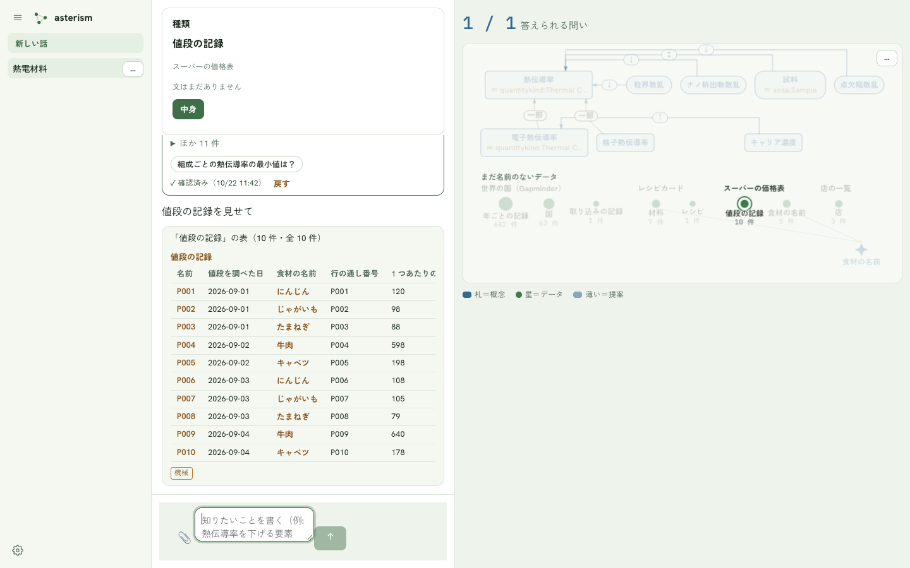

<!--
  Asterism マニュアル（人間向けヘルプ = AI 相談チャットの知識、単一の真実源）。
  getting-started.md の冒頭コメントに書いた表記規約（ボタンは「文言」ボタン、
  タブは「文言」タブ、サイドバーのメニュー項目はメニューの「文言」の形で書く
  こと）は本ファイルにも適用される。
-->

# 見る — 点を押してデータを見る・「見せて」で表

1 件ずつのページや、カード・見せ方を選ぶ画面はありません。見るには 2 つの方法があります。

## 点を押す

知識グラフの緑の丸（データの種類）を押すと、チャットの先頭に 1 枚が出ます。下の「データ」には、その種類の行が 20 件まで表で出ます。
知識グラフの青い丸（用語）を押すと、その用語に結ばれた各データの表が並びます（[知識グラフ](./graph.md)）。

## 「…を見せて」で表

チャットに書くと、表で返ります。

- 例: 「値段の記録を見せて」「試料を見せて」
- 公開済みの種類・用語の名前に、「見せて」「一覧」「表」を付けて書きます
- AI は使いません。決まった型で、20 行までの表を返します（足りないときは「ほか N 件」と出ます）
- 用語を書いたときは、その用語に入っている種類のうち最初の 1 つの表です
- 該当する行がないときは「該当する行はありません」と出ます
- 公開済みのデータだけが対象です

## 答えてほしいとき

数や最大値を知りたいときは、「見せて」でなく「答えて」で書きます。出どころつきの答えが返ります（[質問する](./ask.md)）。

## 関連

- 知識グラフの読み方: [知識グラフ](./graph.md)
- 出どころつきの質問: [質問する](./ask.md)
