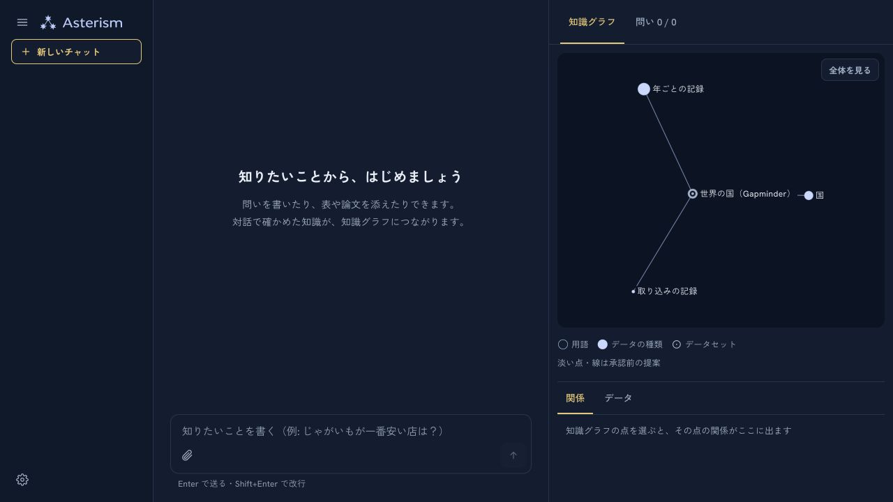
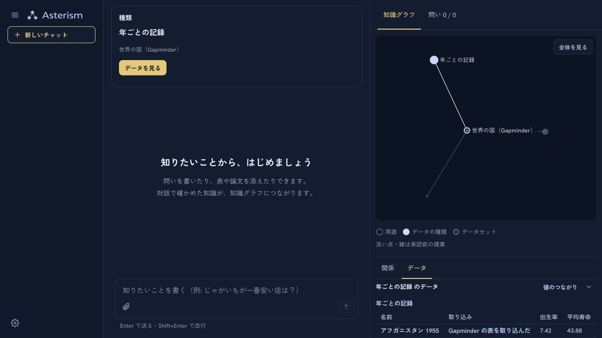
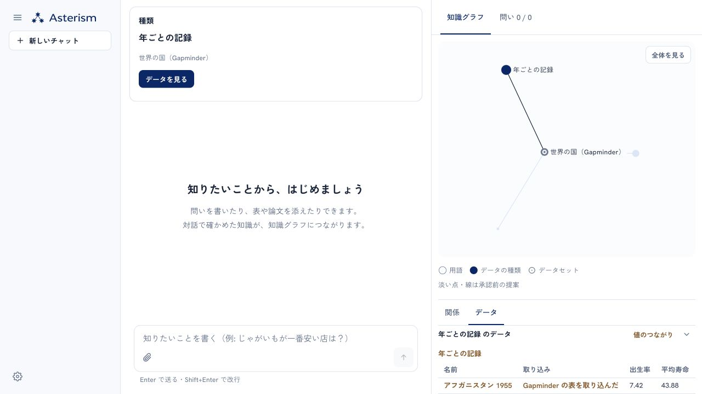
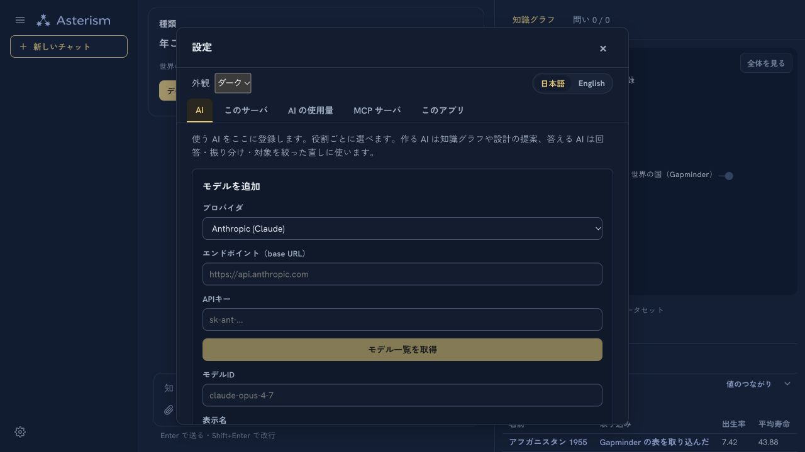
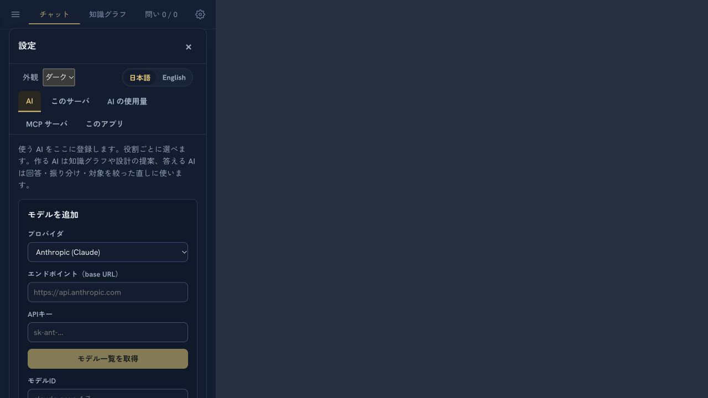
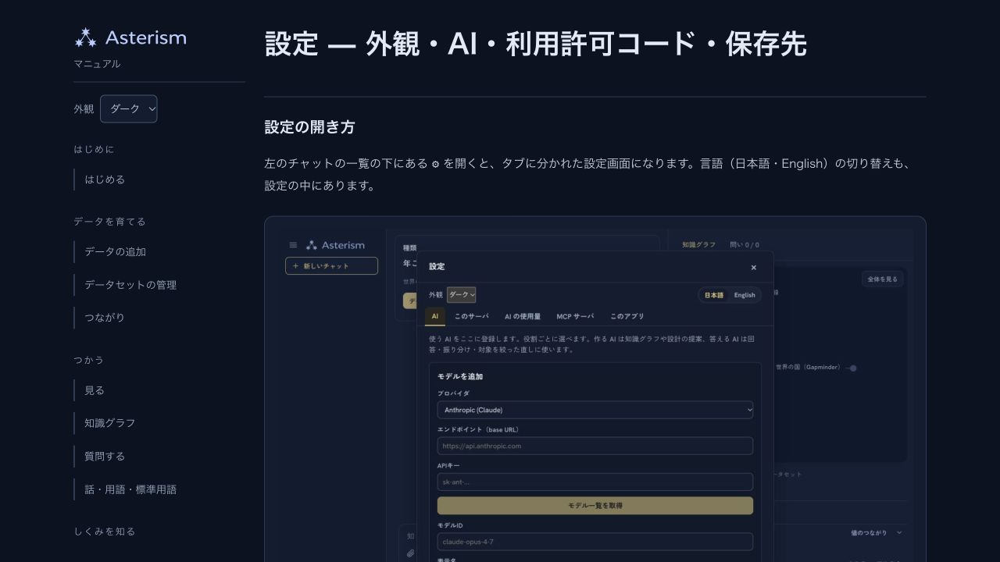
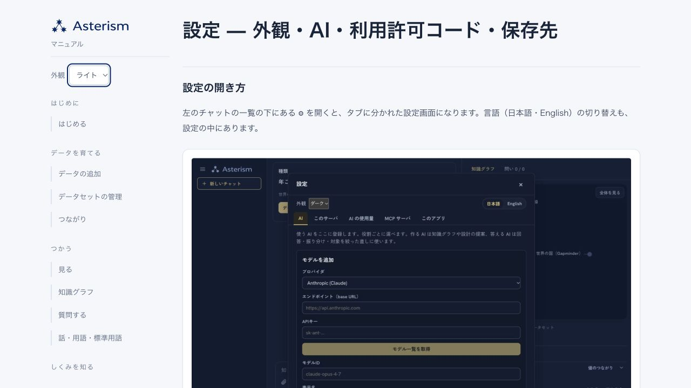
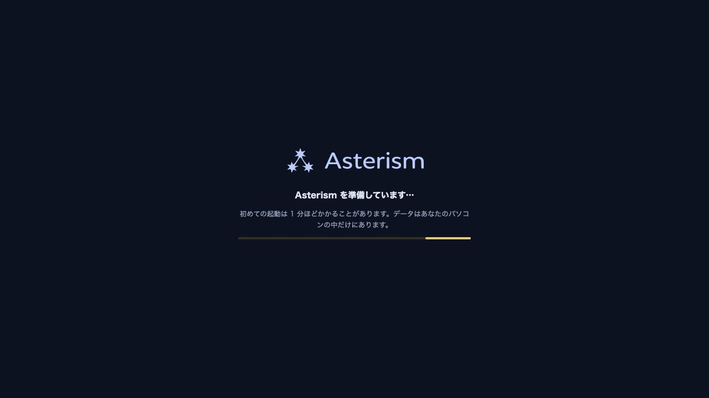

# ブランドと外観の製品反映・リリース前確認

2026-11-10。三つ星 A とロゴタイプ 01 を維持し、濃紺＋淡い金を通常入口に採用。

## 確認結果

- UI: 74 ファイル・1,145 テスト成功。lint / i18n / build 成功。既存の chunk サイズ警告あり。
- 初回ダーク、設定からライトへ切替、再読み込み後のライト保存を実ブラウザで確認。
- Map の選択を保ったまま明暗を切替。カメラ・選択・配置・Sigma 同一性は回帰テストでも確認。
- マニュアルはダーク既定、ライト切替・再読み込み保存とロゴ切替を確認。
- 1280px のアプリ、390px の iframe 内の設定を目視確認。スマートフォン実機の確認ではない。
- 起動画面は HTML として目視確認。ネイティブ起動・署名・更新フィードの確認は配布工程で別途行う。
- 独立レビュー: 重大・中程度の確定欠陥なし（コード・生成物の範囲）。
- ブランド同期 / マニュアル生成物 / マニュアルの版検査 / diff 検査成功。
- 既存 Web サーバは SSH と HTTPS が接続タイムアウト。配布版と Pages の公開とは別で、Web サーバ更新は未実施。

## 実画面

